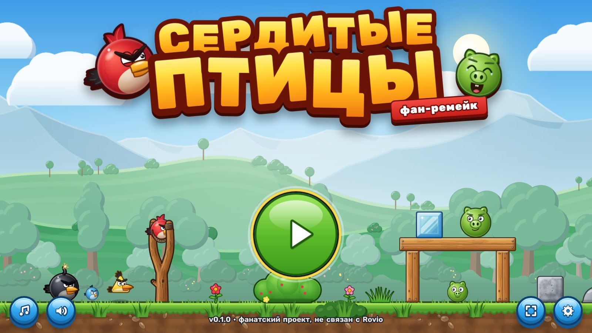
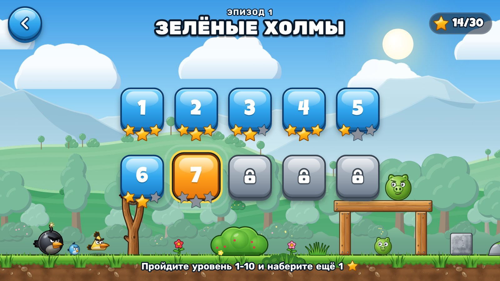
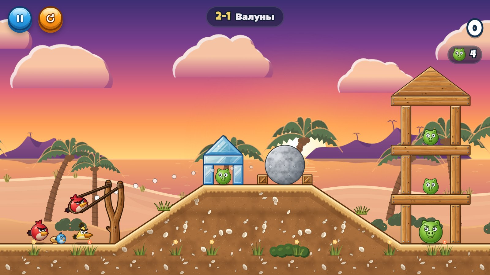
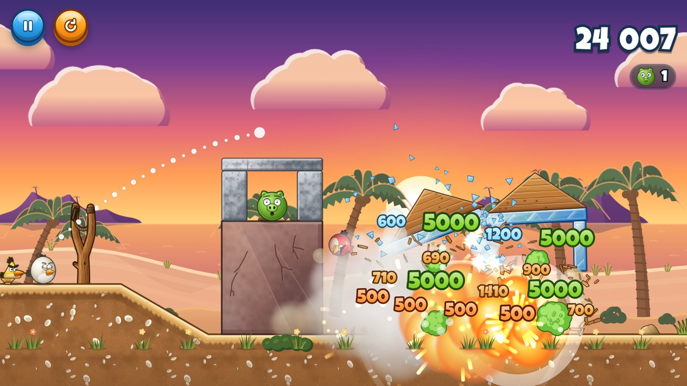
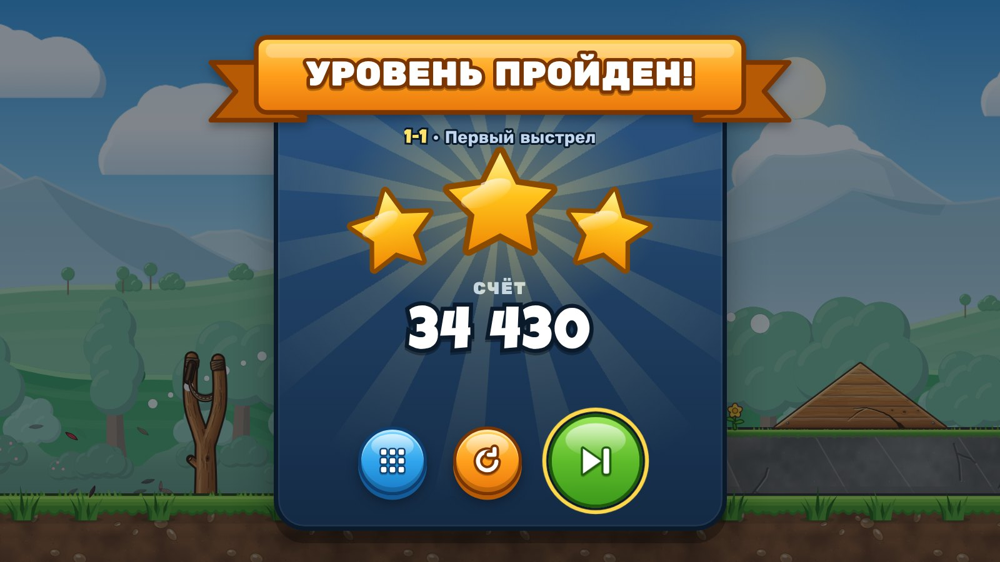
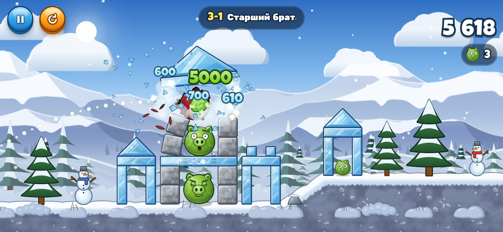

# Сердитые Птицы — фан-ремейк Angry Birds

Браузерная игра в духе Angry Birds 2 (2020): рогатка, восемь птиц со способностями, свиньи в постройках из дерева,
льда и камня, честная физика Box2D, 30 уровней в трёх эпизодах. Интерфейс на русском. Игра работает на компьютере
и на телефоне в ландшафтной ориентации, без установки и без сервера, есть сборка в один HTML-файл.



| Выбор уровня | Прицел |
|---|---|
|  |  |
| **Разрушение и цепочка TNT** | **Победа** |
|  |  |



> **Дисклеймер.** Это фанатский некоммерческий проект. Он не связан с Rovio Entertainment, не одобрен ею и не
> использует её материалы. Angry Birds — торговая марка Rovio. Все ассеты оригинальные: персонажи, фоны, блоки и
> эффекты рисуются кодом на Canvas 2D, звуки и музыка синтезируются через Web Audio. В сборке нет ни одного файла
> изображений или звука: только код и шрифты с открытой лицензией (@fontsource). Картинки в `docs/` — снимки самой
> игры и её страниц предпросмотра.

## Содержание

- [Как играть](#как-играть)
- [Как запустить](#как-запустить)
- [Структура проекта и архитектура](#структура-проекта-и-архитектура)
- [Как проверяются уровни](#как-проверяются-уровни)
- [Технологии](#технологии)

## Как играть

Цель уровня — уничтожить всех свиней. Птицы запускаются из рогатки по одной. Очки дают разрушенные блоки, свиньи и
каждая неиспользованная птица (+10 000). По счёту уровень даёт от одной до трёх звёзд. Звёзды открывают следующие
эпизоды: «Зелёные холмы», «Пляжный закат» и «Снежные вершины».

### Управление

| Действие | Мышь | Тач | Клавиатура |
|---|---|---|---|
| Прицелиться и выстрелить | тянуть птицу из рогатки назад, отпустить | так же, пальцем | — |
| Отменить выстрел | вернуть птицу к рогатке (натяжение меньше 0,5 м) | так же | `Esc` во время прицела |
| Способность птицы | клик во время полёта | касание во время полёта | Пробел или Enter |
| Осмотреть уровень | тянуть фон | тянуть одним пальцем | стрелки (Shift — быстрее) |
| Масштаб | колесо | щипок двумя пальцами | `+` / `−` |
| Весь уровень ↔ вид рогатки | двойной клик | двойное касание | `Z` |
| Пропустить облёт, баннер или подсчёт | клик | касание | Пробел |
| Пауза | кнопка паузы | кнопка паузы | `Esc` или `P` |
| Заново | кнопка «Заново» | кнопка «Заново» | `R` |
| Музыка, весь экран | кнопки на титуле | кнопки на титуле | `M`, `F` |

В настройках можно включить короткую подсказку траектории, выбрать качество графики, отключить тряску экрана и
музыку в уровнях. Пункт «Анимации» по умолчанию следует системной настройке «Уменьшить движение». В этом режиме
нет облёта, тряски и дрейфа фона, а экранная вспышка взрыва слабее.

### Птицы

| Птица | Впервые | Способность (касание в полёте) | Сильна против |
|---|---|---|---|
| Ред | 1-1 | нет — надёжный универсальный удар | дерево, лёд, свиньи |
| Синие (Джей, Джейк, Джим) | 1-4 | делится на трёх маленьких птиц веером | лёд (×2,6) |
| Чак | 1-6 | рывок вперёд: скорость ×1,5 | дерево (после рывка ×2,2) |
| Бомб | 1-8 | взрыв радиусом 3,5 м; без касания взрывается через 2,5 с после удара | камень, всё вокруг |
| Матильда | 2-2 | сбрасывает яйцо-бомбу вниз (взрыв 2,5 м), сама улетает вверх | цели под траекторией |
| Хэл | 2-5 | бумеранг: разворачивается и летит обратно | дерево (×1,6), цели за укрытием |
| Теренс | 3-1 | нет — тяжёлый, пробивает постройки массой | камень (×2,0), всё подряд |
| Сильвер | 3-6 | петля и пике вниз | камень в пике (×3,0) |

### Свиньи

| Свинья | Прочность | Очки за урон | Особенность |
|---|---|---|---|
| Малая | 2,5 | 50 | гибнет от лёгкого толчка |
| Средняя | 5,6 | 100 | |
| Большая | 12,2 | 200 | |
| В каске | 6,7 + каска 10 | 150 | каска гасит удары сверху и сбоку, но не снизу: падение для неё опасно |
| Усатый (бригадир) | 12,5 | 300 | крепкий, часто сидит наверху крепости |
| Король | 31 | 1000 | самый большой; босс финалов 2-10 и 3-10, проще всего взрывом |

Гибель любой свиньи — 5 000 очков, в том числе при падении или вылете за край уровня.

### Материалы

| Материал | Прочность на кг | Очки за разрушение | Поведение |
|---|---|---|---|
| Лёд | 6 | 500 + до 100 за м² | хрупкий, скользкий; Синие колют его лучше всех |
| Дерево | 14 | 500 + до 200 за м² | средний; Чак прошивает его на рывке |
| Камень | 27 | 500 + до 300 за м² | тяжёлый и прочный; нужен Бомб, Теренс или пике Сильвер |
| TNT | 4 | 500 | взрывается от удара, радиус 3 м; соседние ящики детонируют цепочкой |

Блоки и свиньи показывают стадии повреждения: трещины, сколы, синяки. Урон считается по импульсу удара, и его
получают оба тела. Поэтому падающие обломки и катящиеся свиньи тоже разрушают постройку.

## Как запустить

Нужен Node.js 22.12 или новее (рекомендуется 24).

```bash
npm install            # зависимости
npm run dev            # dev-сервер Vite: http://localhost:5173
npm test               # юнит-тесты Vitest (ядро, уровни, рендер, звук, UI, хранилище)
npm run typecheck      # tsc --noEmit
npm run build          # проверка типов + сборка в dist/ (статический сайт, base './')
npm run build:single   # всё в один файл dist-single/index.html (открывается с диска, без сервера)
npm run preview        # посмотреть собранный dist/
```

Дополнительные проверки (нужен Playwright с Chromium):

```bash
node scripts/e2e.mjs                # e2e в Chromium: меню, 30 уровней, кадр камеры, победа, темп, взрыв, FPS
node scripts/e2e.mjs --only victory # только выбранные разделы (flow, framing, flight, victory, tempo, blast…)
node tests/ui/preview-flow.mjs      # сценарии интерфейса: пауза, поворот, окно победы, переходы
node scripts/shot.mjs "index.html?level=2-9&intro=0" out.png --w 1600 --h 900 --wait 3000   # скриншот
node scripts/readme-shots.mjs       # скриншоты для README (после npm run build)
```

Параметры адреса для отладки: `?level=2-9` — сразу в уровень, `&intro=0` — без облёта, `&mute=1` — без звука,
`&seed=7` — зерно физики, `&unlockAll=1` — открыть все уровни, `&quality=high|med|low`, `&fresh=1` — прогресс
только в памяти. В консоли доступны тестовые хуки `window.__game` (см. `src/app/hooks.ts`): `launch(угол, сила)`,
`ability()`, `settle()`, `stats()`, `framing()` и другие.

**Публикация.** Workflow `.github/workflows/deploy.yml` при каждом push в `main` выполняет `npm ci` и `npm run build`,
а затем публикует `dist/` на GitHub Pages. В настройках репозитория нужно выбрать Settings → Pages → Source:
GitHub Actions. Файл `dist-single/index.html` можно просто отправить или открыть локально: стили, шрифты и код уже
внутри.

## Структура проекта и архитектура

Подробная спецификация лежит в [`docs/superpowers/specs/2026-10-24-angry-birds-design.md`](docs/superpowers/specs/2026-10-24-angry-birds-design.md),
план реализации — в [`docs/superpowers/plans/2026-10-24-angry-birds.md`](docs/superpowers/plans/2026-10-24-angry-birds.md).
Исследование оригинала собрано в [`docs/research/`](docs/research/): [сводка с итоговыми числами](docs/research/00-summary.md),
[геймплей](docs/research/01-gameplay.md), [персонажи](docs/research/02-characters.md), [физика](docs/research/03-physics.md),
[визуал](docs/research/04-visual.md), [звук](docs/research/05-audio.md), [уровни](docs/research/06-levels.md),
[интерфейс](docs/research/07-ui-ux.md).

```
app (App, GameScreen, MenuScene) ──► ui, render, audio, input, core, levels, storage
render ──► core (типы и api), config        audio ──► core (события)
ui     ──► core (типы), storage, levels     input ──► render/Camera, core/api
core   ──► planck, config  (без DOM: работает в Node — тесты, решатель, калибровка)
levels ──► core/types
```

| Папка | Что внутри |
|---|---|
| `src/core/` | Логика и физика без DOM. `GameSession` — автомат хода (`ready → aiming → flying → settling → bonus → won/lost`), рогатка, способности, очки. `physics/` — обёртка planck: урон по импульсу, взрывы, сон. `sim/` — решатель, проверка устойчивости, калибровка звёзд. Ядро детерминировано при одинаковом seed |
| `src/config/constants.ts` | Все настраиваемые числа: физика, птицы, свиньи, материалы, камера, тайминги, очки |
| `src/levels/` | 30 уровней (`episode1..3.ts`), заготовки построек (`prefabs.ts`), статическая проверка (`lint.ts`), калибровка звёзд (`calib.ts`) |
| `src/render/` | Canvas 2D: `Renderer` (слои кадра), `Camera` (следование, облёт, тряска, зум), `SpriteCache` (кэш спрайтов по ступеням масштаба). `sprites/` — птицы, свиньи, блоки, рогатка, параллакс-фоны и рельеф трёх тем. `fx/` — частицы, дым, взрывы, всплывающие очки, эффекты способностей |
| `src/audio/` | Web Audio: синтез звуков ударов, материалов и голосов, музыка меню и уровней, микшер с приглушением на взрывах |
| `src/ui/` | DOM/CSS-интерфейс: титул, эпизоды, уровни, HUD, пауза, окна победы и поражения, настройки, ирис-шторка |
| `src/input/` | Указатель, тач и щипок, колесо, клавиатура → команды прицела и камеры |
| `src/app/` | Сборка целого: игровой цикл с фиксированным шагом 1/60 с, `GameCamera` (кадр под уровень и экран), автокачество, прогрев спрайтов под шторкой |
| `src/storage/` | Прогресс и настройки в `localStorage`, миграции схемы |
| `tests/`, `scripts/`, `dev/` | Vitest, e2e и инструменты уровней, страницы предпросмотра графики |

Физика идёт фиксированным шагом 1/60 с, рендер интерполирует положение тел между шагами. Каждый кадр устроен так:
`session.step()` → события → эффекты, звук, камера, HUD → `Renderer`. Спрайты рисуются процедурно один раз на
ступень масштаба и затем копируются через `drawImage`. Тяжёлый прогрев (спрайты, фон, рельеф, первые шаги физики и
эффекты) идёт кусками под шторкой загрузки.

## Как проверяются уровни

Каждый из 30 уровней проходит четыре проверки.

1. **Статическая проверка** (`src/levels/lint.ts`, `npm run levels:lint`). Тела не пересекаются, стоят на опорах,
   центр масс не выходит за опору. Цели лежат в зоне досягаемости рогатки (x ≈ 11…25 м, верх ≤ 11 м), свинья
   стоит не ближе 5 м к рогатке, пороги звёзд кратны 1 000.
2. **Устойчивость** (`npx tsx scripts/level-report.ts`). Все тела будятся, затем идёт 10 с симуляции без выстрелов:
   ни одна свинья не гибнет, ни один блок не разрушается, смещения в пределах сантиметров. Сейчас устойчивы все 30.
3. **Проходимость: решатель** (`src/core/sim/`). Бот-эксперт перебирает выстрелы (угол × сила × момент
   способности) лучом по птицам на настоящем ядре в Node. Найденная линия затем переигрывается с шумом исполнения:
   «мелким» (±0,5°, ±1 % силы, ±1 кадр) и «рукой» (±1,5°, ±3 %, ±3 кадра). Так выбирается линия, которая выигрывает
   и при неточном выстреле, а не одно хрупкое точное решение. Для эпизода 1 и уровней, где появляется новая птица,
   доля побед под мелким шумом должна быть не ниже 60 %.
4. **Звёзды** считаются по устойчивой линии: 2★ — медиана счёта под шумом, 3★ — 80-й перцентиль, пороги круглые.
   Калибровку пишет `npx tsx scripts/level-calibrate.ts 1-7 2-` (уровень или эпизод) в `src/levels/calib.ts`.
   Подробный отчёт по уровню: `npx tsx scripts/level-report.ts 1-3 --solve --robust`.

Vitest повторяет это в `tests/levels/`. `lint.test.ts` гоняет статическую проверку. `campaign.test.ts` проверяет,
что линия эксперта проходит каждый уровень за указанное число птиц и что после хода свинья не оказывается у
рогатки. `tempo.test.ts` следит, чтобы между выстрелами не было пустых пауз. Сам браузерный прогон — в
`scripts/e2e.mjs`: все 30 уровней открываются в трёх размерах экрана, и проверяется, что сооружение, свиньи и
рогатка помещаются в кадр.

## Технологии

| Что | Чем |
|---|---|
| Язык и сборка | TypeScript 7, Vite 8, `vite-plugin-singlefile` (сборка в один файл) |
| Физика | [planck.js](https://github.com/piqnt/planck.js) 1.5 — порт Box2D, того же движка, что в оригинальной Angry Birds |
| Графика | Canvas 2D, процедурные спрайты в кэше offscreen-холстов, многослойный параллакс трёх тем |
| Интерфейс | DOM + CSS поверх холста, Web Animations API, ирис-переходы на SVG |
| Звук | Web Audio API: синтез без файлов, отдельные шины для звуков и музыки |
| Шрифты | Rubik (кириллица), Luckiest Guy и Lilita One (цифры и заголовки) через `@fontsource` |
| Тесты | Vitest (ядро и логика в Node), Playwright + Chromium (e2e, скриншоты, сценарии UI) |
| Публикация | GitHub Actions → GitHub Pages; один HTML-файл для офлайна |
