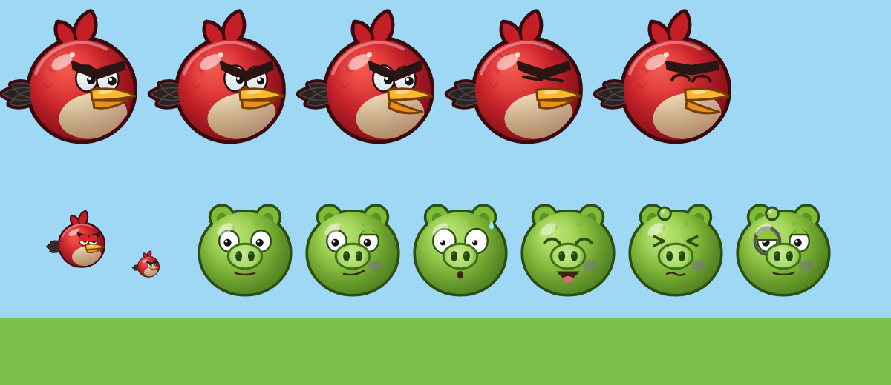

# 02 — Персонажи: птицы и свиньи

Исследовательская спецификация для браузерного клона (TypeScript + Vite, planck.js 1.5.x, Canvas 2D, процедурные спрайты, Web Audio).
Уровень качества — мобильная серия ~2020 (Angry Birds 2 / Friends / Classic). Все спрайты и звуки — **оригинальные**, рисуются и синтезируются кодом: узнаваемы по стилю (круглые «злые» птицы, зелёные свиньи), но не копируют спрайты Rovio.

Легенда пометок:
- **[факт]** — поведение подтверждается открытыми источниками (фан-вики, TV Tropes, MobyGames, GiantBomb; см. «Источники»).
- **[рекомендация]** — точных данных об оригинале нет (Rovio не публикует параметры Box2D; см. arXiv 1905.12877), значение подобрано и откалибровано расчётом ниже.

---

## 0. Соглашения и единицы

| Параметр | Значение | Комментарий |
|---|---|---|
| Мир | метры, ось Y **вверх**, шаг 1/60 с | общее для проекта |
| `R_RED` | **0.45 м** (согласовано с `01-gameplay.md`) | базовый радиус Red; *все* размеры персонажей заданы в долях `R_RED`. Если физдок задаст другой масштаб — меняем только эту константу |
| `V_LAUNCH_MAX` | **29 м/с** (= `V_MAX` в 01) | макс. скорость вылета при полном натяжении; скорости способностей ниже выражены через неё (`K·V_LAUNCH_MAX`) |
| `G` | **12.5 м/с²** (01) | при другом g скорости способностей масштабируются вместе с `V_LAUNCH_MAX` (`∝ √g`), тайминги — нет |
| `launchScale` | из 01: Bomb 0.95, Matilda 0.97, Terence 0.88, остальные 1.0 | множитель скорости запуска по птицам |
| Плотность | кг/м² (2D Box2D) | масса = плотность × площадь фигуры |
| Спрайт-пространство | единица = физический радиус персонажа `r`, начало = центр тела, **+x = вперёд (клюв)**, **+y = вниз** (canvas) | птицы смотрят вправо; свиньи рисуются анфас (симметрично) |
| Обводка | `OUT = 0.07 r`, но не тоньше 1.5 px | см. §5 |

Перевод «мир → экран» при отрисовке: `ctx.translate(sx, sy); ctx.rotate(-body.getAngle()); ctx.scale(rPx*sqx, rPx*sqy)` (минус у угла — потому что у canvas Y вниз).

---

## 1. Сводная таблица птиц

Размер — радиус относительно Red. Масса — при `R_RED = 0.45 м`. Колонка «×Red» — отношение масс; для Blues, Chuck, Bomb, Matilda, Hal и Terence оно подогнано под ориентиры из 01 (0.6× / 0.9× / 1.6× / 1.2× / 1.0× / 4×). Исключение — Blues: 0.47× вместо 0.6×. Втроём они несут 1.4× импульса Red; при 0.6× было бы 1.8×, и «стекольные» птицы сносили бы дерево.

| id | Имя | Форма тела (физика) | r / R_RED | r, м | Плотность | Масса, кг | ×Red | friction | restitution | angularDamping | Способность (тап) |
|---|---|---|---|---|---|---|---|---|---|---|---|
| `red` | Red | circle | 1.00 | 0.450 | 2.0 | 1.27 | 1.00 | 0.55 | 0.32 | 0.6 | Battle Cry (AB2) / нет (Classic) |
| `blues` | The Blues (Jay/Jake/Jim) | circle | 0.56 | 0.252 | 3.0 | 0.60 (каждый) | 0.47 | 0.50 | 0.30 | 0.6 | Сплит на 3 |
| `chuck` | Chuck | triangle | 1.10 (описанный) | см. §3.3 | 3.3 | 1.15 | 0.90 | 0.45 | 0.25 | 0.8 | Рывок |
| `bomb` | Bomb | circle | 1.30 | 0.585 | 1.9 | 2.04 | 1.61 | 0.60 | 0.20 | 0.7 | Взрыв (тап или авто) |
| `matilda` | Matilda | circle | 1.20 | 0.540 | 1.65 → 0.5 | 1.51 → 0.46 | 1.19 | 0.55 | 0.30 | 0.6 | Яйцо-бомба вниз, сама — вверх |
| `hal` | Hal | circle (+клюв визуально) | 1.05 | 0.4725 | 1.8 | 1.26 | 0.99 | 0.50 | 0.30 | 0.5 | Бумеранг |
| `terence` | Terence | circle | 1.78 | 0.800 | 2.5 | 5.03 | 3.95 | 0.70 | 0.15 | 0.9 | нет (только рык) [факт] |
| `silver` | Silver | circle | 1.00 | 0.450 | 2.2 | 1.40 | 1.10 | 0.50 | 0.28 | 0.6 | Петля + пике вниз |
| `stella` | Stella | circle | 0.95 | 0.4275 | 1.8 | 1.03 | 0.81 | 0.55 | 0.30 | 0.6 | Пузырь-ловушка |
| `bubbles` | Bubbles | circle (растёт) | 0.72 → 2.59 | 0.324 → 1.166 | 2.0 → 0.47 | 0.66 → 2.0 | 0.52 | 0.50 | 0.40 | 0.6 | Надувание |

Общие свойства всех птиц [рекомендация]: `bullet: true` в полёте (CCD), `linearDamping: 0`, начальный `angularVelocity: 0` (птица летит «ровно» и начинает катиться только после удара), категория коллизий `CAT_BIRD = 0x0002`.

### 1.1. Множители урона по материалам

Урон = импульс удара × множитель (модель — §2). Колонка `explosion` — множитель для урона от взрыва этой птицы.

| id | wood | ice | stone | pig | Сильна против | Комментарий |
|---|---|---|---|---|---|---|
| `red` | 1.0 | 1.0 | 0.7 | 1.0 | — (универсал) | базовая линия |
| `blues` | 0.5 | **2.6** | 0.3 | 0.5 | стекло/лёд [факт] | каждая из трёх; по свиньям 0.5 — чтобы одна Blue не убивала large |
| `chuck` | 1.2 → **2.2** после рывка | 0.6 | 0.4 | 1.0 | дерево [факт] | слаб против стекла и камня [факт] |
| `bomb` (тело) | 0.9 | 0.8 | 1.0 | 1.0 | — | |
| `bomb` (взрыв) | 1.0 | 1.25 | **1.4** | 1.0 | камень | |
| `matilda` (тело) | 0.7 | 0.7 | 0.5 | 0.8 | — | после сброса яйца — 0.3 по всем |
| `matilda` (яйцо, взрыв) | 1.0 | 1.0 | 1.0 | 1.0 | всё понемногу | |
| `hal` | **1.6** | 0.8 | 0.5 | 1.0 | дерево, удар «с тыла» | |
| `terence` | 1.6 | 1.6 | 1.6 | 1.5 | всё [факт: «ломает любой материал»] | основное — масса |
| `silver` (обычн./пике) | 1.0 / 1.3 | 1.0 / 1.3 | 0.7 / **2.6** | 1.0 | камень в пике [факт] | |
| `stella` | 0.8 | 0.8 | 0.6 | 0.8 | — | урон наносит падение поднятых тел |
| `bubbles` | 1.0 | 0.7 | 0.5 | 0.9 | дерево [факт] | надувание толкает, а не ломает [факт] |

---

## 2. Контракт урона и «пробития» (общий для птиц и свиней)

Это минимальный контракт, который нужен персонажам. Материалы и HP блоков — в документе по материалам; здесь даны ориентиры для калибровки.

### 2.1. Урон от контакта [рекомендация]

```ts
// preSolve: запоминаем скорость сближения (только один раз на контакт)
const wm = contact.getWorldManifold(null);
const n = wm.normal;                       // от A к B
const p = wm.points[0];
const vA = bodyA.getLinearVelocityFromWorldPoint(p);
const vB = bodyB.getLinearVelocityFromWorldPoint(p);
const vn = -Vec2.dot(Vec2.sub(vB, vA), n); // >0 — сближаются
contactData.impact = vn > V_IMPACT_MIN;    // V_IMPACT_MIN = 1.0 м/с
contactData.vn = Math.max(contactData.vn ?? 0, vn);

// postSolve: урон = сумма нормальных импульсов, только для «ударных» контактов
if (contactData.impact) {
  let J = 0; for (const ni of impulse.normalImpulses) J += ni;   // Н·с
  if (J > J_MIN) {                                              // J_MIN = 0.25 Н·с
    applyDamage(targetOf(A), J * mult(A_source, B_material));
    applyDamage(targetOf(B), J * mult(B_source, A_material));
  }
}
// источник «земля/статика» для свиньи: mult = 0.7 (падение со своей высоты не так смертельно)
```

Почему так: покоящиеся стопки дают каждый шаг импульс `m·g·dt`, но `vn ≈ 0` → урона нет (свинья под камнем не «тает»). Удар даёт `J ≈ μ·(1+e)·vn`, где `μ = m1·m2/(m1+m2)`, а `e = max(eA, eB)` (смешивание restitution в Box2D/planck).

### 2.2. Калибровка (расчёт: `R_RED = 0.45`, `G = 12.5`, HP из §4)

| Сценарий | J × mult, Н·с | Результат |
|---|---|---|
| Red 29 м/с → large pig (1.74 кг) | 0.735·1.32·29 ≈ 28.1 | убивает (HP 8) |
| Red 15 м/с → medium pig (0.93 кг) | 0.537·1.32·15 ≈ 10.6 | убивает (HP 4.5) |
| Red 5 м/с (докатилась) → medium pig | ≈ 3.5 | **не** убивает |
| Red 29 м/с → king pig (3.44 кг) | 0.929·1.32·29 ≈ 35.6 | **не** убивает (HP 40), нужно 2 попадания |
| Terence 25.5 м/с (launchScale 0.88) → king pig | 2.04·1.15·25.5·1.5 ≈ 90 | убивает |
| одна Blue 25 м/с → small / medium / large | (7.9 / 11.8 / 14.4)·0.5 ≈ 3.9 / 5.9 / 7.2 | убивает small и medium, large — нет |
| доска 0.5 кг падает на small pig с 1.5 м / 3 м | 1.66 / 2.35 | выживает / погибает (HP 2) |
| камень 1.73 кг падает с 1.5 м на small / medium | 2.45 / 4.44 | small погибает, medium едва выживает |
| small pig падает на землю с 1 / 2 / 3 м (×0.7) | 1.66 / 2.35 / 2.87 | выживает / погибает / погибает |

Ориентир HP блока 1×1 (0.85 м, как в 01) для документа материалов [рекомендация]: **ice ≈ 5, wood ≈ 10, stone ≈ 30** (единицы «Н·с × множитель»; массы блоков ≈ 0.65 / 0.5 / 1.73 кг). Проверка: Red 29 м/с ломает дерево (13.7) и прошивает стекло (16.5), камень не берёт (19.6 с ×0.7); Blue 25 м/с колет стекло (26.3), дерево — нет (4.4); Chuck после рывка 38 м/с проходит 3–4 деревянных блока (36.4 на первом, ×2.2), камень не берёт (13.1); Silver в пике 32 м/с ломает камень (82).

### 2.3. Пробитие (pass-through) [рекомендация]

Без этого Blues не «прошивают» стекло, а Chuck — дерево. В `preSolve` контакта птица↔блок (и птица↔свинья):

```ts
const Jest = mu(bird, target) * (1 + e) * vn * mult(bird, target.material);
if (Jest >= target.hp && !target.indestructible) {
  contact.setEnabled(false);                 // птица проходит насквозь
  target.markDestroyed(Jest);                // удалить после world.step()
  const keep = Math.sqrt(Math.max(0.2, 1 - target.hp / Jest)); // доля сохранённой энергии → скорость
  bird.pendingVelScale = Math.min(bird.pendingVelScale, keep);  // применить после шага
}
```
Тело в статусе `destroyed` больше не создаёт включённых контактов (проверка в `preSolve`). Для свиней — то же: свинья лопается, птица летит дальше (как в оригинале).

---

## 3. Способности: точное поведение

### 3.0. Общие правила активации

| Правило | Значение |
|---|---|
| Ввод | тап/клик в любом месте экрана (кроме UI) во время полёта |
| Окно | от `t_launch + 0.05 с` (`ABILITY_MIN_DELAY` в 01) до **первого удара** (контакт с `J > 1 Н·с`) [факт: способность одна на полёт] |
| Исключения | Bomb — тап работает и после удара (детонация); Bubbles — авто-надувание через 1.0 с после первого удара [факт]; Stella — авто-пузырь при первом ударе [факт] |
| Повторный тап | игнорируется (одна активация) [факт] |
| Фидбек | вспышка-кольцо: окружность r → 2.2r, stroke `#FFFFFF` α 0.8→0, ширина 0.15r, 0.25 с; звук способности; микротряска 0.08 м / 0.12 с — только Bomb и Chuck (как в 01) |
| Маркер в траектории | при активации — крупная точка трейла `TRAIL_R_ABILITY = 0.22 м` (01) |
| Камера | следует за «главным» телом способности (см. по птицам) |

Машина состояний птицы:
`Queued → Hopping(0.45 с) → OnSling → Aiming → Flying → AbilityActive? → Impacted → Resting → Poof(удалить)`.
Критерии `Resting`/ухода птицы — из 01 (`RETIRE_*`: покой `|v| < 0.25 м/с`, `|ω| < 0.5 рад/с` 0.4 с, но не раньше 1.0 с после контакта; максимум 6.0 с после контакта; вылет за границы мира) → «пуф» (§8.5).

### 3.1. Red — Battle Cry

- **Classic**: способности нет (тап → только крик) [факт для Classic].
- **AB2-режим (по умолчанию)**: «боевой клич» — ударная волна-конус вперёд, толкающая конструкции [рекомендация по описаниям AB2].

```ts
// на тап
const dir = normalize(bird.v);              // направление полёта
for (b of queryAABB(bird.pos, RANGE)) {      // RANGE = 3.5 м (≈ 7.8 R_RED, ≈ 4 блока 0.85 м)
  if (b.isStatic() || b === bird) continue;
  const to = sub(b.center, bird.pos); const d = len(to);
  if (d > RANGE) continue;
  const cos = dot(to, dir) / Math.max(d, 1e-3);
  if (cos < Math.cos(55 * DEG)) continue;    // полуугол конуса 55°
  const f = 1 - d / RANGE;                   // линейный спад
  const dv = 5.0 * f;                        // Δv_max = 5 м/с (доска 0.5 кг у Red — полные 5 м/с)
  const J = Math.min(b.getMass() * dv, 6);   // кап 6 Н·с: камень 1.73 кг ≤ 3.5 м/с, King ≤ 1.7 м/с
  b.applyLinearImpulse(mul(normalize(add(mul(to,1/d), {x:0,y:0.25})), J), b.getWorldCenter(), true);
}
bird.setLinearVelocity(mul(bird.v, 0.85));   // сам слегка тормозит
```
Урона клич не наносит — разрушения дают падения. Визуал: 3 концентрические дуги (`#FFFFFF`, α 0.7 → 0), сектор ±55°, радиус 0 → 3.5 м за 0.3 с; рот открыт, брови максимально опущены.

### 3.2. The Blues — сплит на троих [факт: на 3, лучше против стекла]

- Исходная птица продолжает полёт как **средняя**; создаются 2 новых тела того же радиуса (0.56 R_RED = 0.252 м) и массы.
- Углы: вектор скорости поворачивается на **+8° (верхняя)** и **−8° (нижняя)** (`BLUES_SPREAD_RAD = 0.14` в 01) [рекомендация; диапазон тюнинга 7–14°]. Модуль скорости у всех трёх одинаков и равен |v| в момент тапа.
- Позиция: смещение перпендикулярно скорости на **±2.3·r_blue** (≈ ±0.58 м). Если точка спавна пересекается со статикой или блоком (`queryAABB` + `testPoint`), птица появляется в позиции средней.
- Фильтр: `groupIndex = -k` (уникальный отрицательный на запуск) → сёстры не сталкиваются друг с другом.
- Каждой — свой трейл; лёгкое вращение ±2 рад/с (визуальная «живость»).
- Камера — центроид живых сестёр (как в 01).

Проверка приёмки: через 10 м пути после сплита расстояние между крайними ≈ `2·10·tan8° ≈ 2.8 м` (гравитация на это не влияет: ускорение у всех трёх одинаковое).

Имена/различия Jay/Jake/Jim [рекомендация]: геймплейно идентичны; визуально — число перьев хохолка 1/2/3 и оттенок `#5DB9EA / #58B2E4 / #62BFEF`.

### 3.3. Chuck — рывок [факт: «удваивает скорость» по TV Tropes; замер Allain — ≈ 1.3× от максимальной скорости запуска; хорош против дерева]

Физическая форма — треугольник (вершины в мировых единицах, CCW, Y вверх):
`[(0, 1.10r_R), (-1.00r_R, -0.62r_R), (1.00r_R, -0.62r_R)]` → основание 0.90 м, высота 0.774 м, площадь 0.348 м² (planck посчитает центроид сам: он на 0.047·r_R ниже начала координат).

```ts
// на тап. Совмещаем оба источника: нижняя граница — замер (1.3·V_MAX, = CHUCK_BOOST_SPEED_K в 01),
// а ×1.5 даёт ощущение «удвоения», если тапнуть на излёте
const s = len(bird.v), dir = normalize(bird.v);  // направление ТЕКУЩЕЙ скорости, не прицела
const s2 = clamp(1.5 * s, 1.3 * V_LAUNCH_MAX, 1.6 * V_LAUNCH_MAX); // 37.7…46.4 м/с; за шаг ≤ 0.77 м < maxTranslation 2 м
bird.setLinearVelocity(mul(dir, s2));
bird.setBullet(true);
bird.mult.wood = 2.2;                 // усиленный режим до первого удара
bird.alignToVelocity = true;          // спрайт носом по скорости (как ракета) до удара
```
Гравитация остаётся 1.0 — при такой скорости траектория выглядит почти прямой. Визуал: 6 «линий скорости» за птицей длиной 1.5–3 r, `#FFF6C8` α 0.6, живут 0.15 с; звук «вжух». После первого удара — `mult.wood = 1.2`, `alignToVelocity = false`.

### 3.4. Bomb — взрыв [факт: по тапу или «через несколько секунд» после удара]

| Параметр | Значение |
|---|---|
| Детонация по тапу | в любой момент после вылета (и до, и после удара) |
| Автоподрыв | **2.5 с** после первого удара с `J > 1 Н·с` [рекомендация] |
| Предупреждение | последние 1.5 с: мигание тинтом `#FF4A1C` (α 0 ↔ 0.7) с частотой 2 → 10 Гц (линейно, как в 01), пульс масштаба 1 ↔ 1.10, искры у фитиля |
| Радиус `R_BLAST` | **2.6 м** (≈ 5.8 R_RED ≈ 3 блока 0.85 м) [рекомендация] |
| Импульс в центре `J0` | 10 Н·с × `clamp(√m, 0.5, 2)` → Δv у центра: доска 0.5 кг ≈ 14 м/с (взлетает на ≈ 8 м), камень 1.73 кг ≈ 7.6 м/с, small pig ≈ 15.6 м/с, King ≈ 5.4 м/с |
| Урон в центре `D0` | 60 (× explosion-множитель материала: wood 1.0, ice 1.25, stone 1.4, pig 1.0) |
| Спад | `f = (1 − d/R)²` |
| Само тело | удаляется в момент взрыва (без «пуфа», взрыв его заменяет) |
| FX | см. §8.6; shake 0.25 м, затухание 0.35 с; белая вспышка экрана α 0.35, 0.08 с |

```ts
function explode(p: Vec2, R: number, J0: number, D0: number, m: MatMult) {
  const set = new Set<Body>();
  world.queryAABB(AABB(p.x-R, p.y-R, p.x+R, p.y+R), fx => (set.add(fx.getBody()), true));
  for (const b of set) {
    if (b.isStatic()) continue;
    const c = b.getWorldCenter();
    const d = Math.max(0, dist(p, c) - 0.5 * b.userData.boundR);  // ближе к краю тела
    if (d > R) continue;
    const f = (1 - d / R) ** 2;
    let dir = normalize(sub(c, p)); if (!isFinite(dir.x)) dir = {x:0, y:1};
    dir = normalize({x: dir.x, y: dir.y + 0.25});                  // подъём вверх — зрелищнее
    const J = J0 * f * clamp(Math.sqrt(b.getMass()), 0.5, 2.0);   // √m: лёгкие летят дальше, но тяжёлые тоже сдвигаются
    const off = mul(perp(dir), (Math.random()-0.5) * b.userData.boundR * 0.6); // закрутка
    b.applyLinearImpulse(mul(dir, J), add(c, off), true);
    damage(b, D0 * f * m[b.userData.material]);
  }
}
```
Окклюзия не учитывается [рекомендация: в оригинале взрыв задевает и блоки «за» блоками].

### 3.5. Matilda — яйцо вниз, сама вверх [факт: «сбрасывает взрывное яйцо и улетает вверх под углом»]

```ts
// на тап
const facing = Math.sign(bird.v.x) || 1;
spawnEgg({
  pos: add(bird.pos, {x: 0, y: -0.7 * bird.r}),
  radius: 0.5 * R_RED,           // 0.225 м
  density: 8.0,                  // 1.27 кг (= масса Red) — тяжёлое, бьёт сильно
  velocity: {x: 0, y: -0.7 * V_LAUNCH_MAX},  // ≈ −20 м/с (как в 01), строго вниз, независимо от скорости птицы
  bullet: true, restitution: 0, filterGroup: bird.group, // не сталкивается с Матильдой
});
const s = Math.max(len(bird.v), 0.62 * V_LAUNCH_MAX);   // ≥ 18 м/с
bird.setLinearVelocity({x: facing * s * Math.cos(60*DEG), y: s * Math.sin(60*DEG)}); // вверх-вперёд 60°
bird.setAngularVelocity(-6 * facing);  // кувырок
bird.getFixtureList()!.setDensity(0.5); bird.resetMassData(); // 0.46 кг (planck API); урон тела × 0.3
bird.gravityScale = 0.6; bird.despawnAfter = 3.0; // улетает за экран
camera.follow(egg);
```
Яйцо: взрывается при **первом** контакте с чем угодно (`beginContact`): `explode(p, R=2.0 м, J0=7, D0=45, всё ×1.0)`; FX — меньшая версия взрыва Bomb + 8 осколков скорлупы.

### 3.6. Hal — бумеранг [факт: разворачивается назад; бьёт конструкции с тыла]

Алгоритм — кинематическое управление скоростью на время разворота [рекомендация]:

```ts
// на тап
const s = Math.max(len(bird.v), 0.9 * V_LAUNCH_MAX) * 1.15;   // ≥ 30 м/с
let a = Math.atan2(bird.v.y, bird.v.x);                       // текущий курс
const side = Math.cos(a) >= 0 ? +1 : -1;                      // летит вправо → поворот CCW (через «верх»)
const aEnd = Math.PI - a - side * 10 * DEG;                    // зеркальный курс, поднятый на 10° вверх
let delta = normAngle0to2PI(side * (aEnd - a));               // суммарный угол поворота
const OMEGA = 8.0;                                             // рад/с → радиус дуги s/ω ≈ 3.75 м
bird.gravityScale = 0;
ability.update = (dt) => {
  const step = Math.min(OMEGA * dt, delta); delta -= step; a += side * step;
  bird.setLinearVelocity({x: s * Math.cos(a), y: s * Math.sin(a)});
  if (delta <= 0) { bird.gravityScale = 1; ability.done = true; }
};
bird.visualSpin = 22;  // рад/с — спрайт вращается как бумеранг, пока идёт дуга; затем затухает за 0.4 с
```
Примеры (полёт вправо): курс −30° (снижается) → конечный 200° (влево, 20° вниз), поворот 230° CCW (≈ 0.50 с): вверх, назад, вниз-влево. Курс +30° (набирает высоту) → 140° (влево, 40° вверх), поворот 110° (≈ 0.24 с). Полёт влево — зеркально (поворот CW). Звук — свист с частотной модуляцией в такт вращению (§10).

### 3.7. Terence — без способности [факт]

Тап — только низкий рык (§10) и сведённые брови на 0.6 с. Сила — масса 5.03 кг (≈ 4× Red, как в 01) и множитель 1.6 по всем материалам; `launchScale 0.88` (01) — летит чуть медленнее. Визуальный бонус: при ударе `J > 30` — пылевое кольцо от точки контакта (8 клубов `#C9B79A`), shake 0.12 м.

### 3.8. Silver — петля и удар вниз [факт: петля 360° вперёд-вверх, затем пикирует вертикально вниз; мощна против камня; лёгкие предметы подбрасывает]

```ts
// на тап
const s = Math.max(len(bird.v), 0.55 * V_LAUNCH_MAX);   // ≥ 16 м/с
let a = Math.atan2(bird.v.y, bird.v.x);
const side = Math.cos(a) >= 0 ? +1 : -1;     // вправо → CCW: вперёд, вверх, назад, вниз
let left = 2 * Math.PI;                        // полная петля
const OMEGA = 11;                              // рад/с → петля 0.57 с, радиус s/ω ≈ 1.5 м
bird.gravityScale = 0;
ability.update = (dt) => {
  if (left > 0) {
    const st = Math.min(OMEGA * dt, left); left -= st; a += side * st;
    bird.setLinearVelocity({x: s*Math.cos(a), y: s*Math.sin(a)});
    bird.visualAngle = a;                      // спрайт по касательной (делает «бочку»)
  } else {                                     // фаза пике
    bird.setLinearVelocity({x: 0.1 * side * s, y: -1.05 * V_LAUNCH_MAX});   // ≈ −30 м/с
    bird.gravityScale = 1; bird.setBullet(true);
    bird.mult = {wood: 1.3, ice: 1.3, stone: 2.6, pig: 1.0};
    bird.visualAngle = -Math.PI/2;             // клювом вниз
    ability.update = null;
  }
};
// первый удар в фазе пике → «слэм»:
onFirstImpactInDive(p) {
  for (b of bodiesWithin(p, 1.2)) if (!b.isStatic() && b.getMass() < 3)
    b.applyLinearImpulse({x: 0, y: b.getMass() * 4 * (1 - d/1.2)}, b.getWorldCenter(), true);
  spawnDustRing(p, 10); shake(0.15, 0.25);
}
```
Если пике начинается внутри геометрии (петля задела блок) — петля прерывается первым ударом, способность считается использованной.

### 3.9. Stella — пузырь [факт: пузыри поднимают блоки и свиней, держатся ~3 с, затем лопаются и роняют]

```ts
// на тап (или при первом ударе, если не тапнули [факт: «или при ударе»])
const R = 2.2;                         // м, радиус захвата
const victims = bodiesWithin(bird.pos, R)
  .filter(b => !b.isStatic() && b.getMass() <= 4.5)  // Terence (5 кг) не берём; King (3.4 кг) — берём
  .sort(byDistance).slice(0, 8);                      // максимум 8 тел + сама Stella
for (const b of [bird, ...victims]) {
  b.saved = {g: b.getGravityScale(), ld: b.getLinearDamping(), ad: b.getAngularDamping()};
  b.setGravityScale(-0.3);            // при G = 12.5: чистое ускорение вверх 3.75 м/с²
  b.setLinearDamping(2.5);            // терминальная скорость ≈ a/c = 1.5 м/с → подъём ≈ 3.5 м за 2.8 с
  b.setAngularDamping(2.0);
  b.bubble = {t: 0, r: 1.15 * b.userData.boundR};     // визуальный пузырь вокруг каждого
}
bird.setLinearVelocity(mul(bird.v, 0.2));
after(2.8, popAll);                    // лопнуть: восстановить параметры, звук pop, 6 капель-брызг
```
Урон от самого пузыря — 0; урон наносит падение после «поп». Пузырь, задетый быстрым телом (`vn > 6 м/с`), лопается раньше [рекомендация].

### 3.10. Bubbles — надувание [факт: тап или ~1 с после удара; раздувается в несколько раз, расталкивает, затем сдувается]

| Фаза | Длительность | Действие |
|---|---|---|
| Ожидание | до тапа или 1.0 с после первого удара | — |
| Надувание | 0.13 с (8 шагов) | радиус `0.324 → 1.166 м` (×3.6) по `easeOutBack`; фикстура пересоздаётся каждый шаг; плотность подбирается так, чтобы масса росла линейно `0.66 → 2.0 кг` |
| Толчок | в первый шаг надувания | радиальный толчок в радиусе 1.8 м: `Δv = 6·(1 − d/1.8)` м/с, `J = min(m·Δv, 8 Н·с)`; урон `6·f×mult` |
| Удержание | 1.8 с | неподвижные глаза-«бусины», щёки надуты |
| Сдувание | 0.5 с | радиус → 0.324 м, масса → 0.66 кг; каждые 1/60 с импульс 0.6 Н·с в направлении, вращающемся 9 рад/с («шарик без узла»), звук «пфффт» |
| Конец | — | «пуф» (§8.5) |

```ts
function setRadius(body: Body, r: number, mass: number) {
  const old = body.getFixtureList()!; const fd = old.getUserData().def; // исходный FixtureDef храним в userData при создании
  body.destroyFixture(old);
  body.createFixture(new Circle(r), {...fd, density: mass / (Math.PI * r * r)});
  body.setBullet(false);
}
```
Прирост фикстуры внутри конструкции сам расталкивает тела через разрешение проникновения; явный импульс добавляет «панч».

---

## 4. Свиньи

### 4.1. Таблица

| id | Название | r / R_RED | r, м | Плотность | Масса, кг | HP | Броня | Очки | friction / restitution / angularDamping |
|---|---|---|---|---|---|---|---|---|---|
| `pig_small` | Minion small | 0.90 | 0.405 | 0.8 | 0.41 | 2 | — | 5000 | 0.6 / 0.15 / 0.5 |
| `pig_medium` | Minion medium | 1.35 | 0.6075 | 0.8 | 0.93 | 4.5 | — | 5000 | 0.6 / 0.15 / 0.5 |
| `pig_large` | Minion large | 1.85 | 0.8325 | 0.8 | 1.74 | 8 | — | 5000 | 0.6 / 0.12 / 0.6 |
| `pig_helmet` | Corporal (каска) | 1.40 | 0.630 | 0.9 | 1.12 | 5.5 | каска HP 8, поглощает 60–90% | 5000 | 0.6 / 0.12 / 0.6 |
| `pig_foreman` | Foreman (усы) | 1.60 | 0.720 | 0.85 | 1.38 | 10 | — | 5000 | 0.6 / 0.12 / 0.6 |
| `pig_king` | King Pig | 2.60 | 1.170 | 0.8 | 3.44 | 40 | корона — визуал | 5000 | 0.65 / 0.10 / 0.8 |

Очки за урон по свиньям (`PTS_PIG_DMG`) и всплывающие числа задаёт 01. В 01 для King предложено «HP ×6 от обычной свиньи». Наши 40 — это 5× large и ≈ 9× medium, то есть в пределах этого ориентира.

Иерархия прочности [факт: large слабее corporal/foreman/king; medium слабее large, helmet, foreman, king]. У нас эффективная прочность (урон до гибели): `small 2 < medium 4.5 < large 8 < foreman 10 < helmet ≈ 13.5 < king 40`. Расчёт для Corporal при средней доле каски 75%: каска ломается после `8/0.75 ≈ 10.7` урона (тело к этому моменту получило ≈ 2.7), затем ещё 2.8 → итого ≈ 13.5. Значит, Red на 29 м/с (≈ 22.8 по этой свинье) убивает её с одного попадания, а на 15 м/с (≈ 11.8) нужно два.

Физика: тело — `circle` (визуально эллипс `rx 1.0, ry 0.94`). Категория `CAT_PIG = 0x0004`. Свинья гибнет при `hp ≤ 0` или вылете за границы мира. После смерти — удалить тело на следующем шаге, «пуф» (§8.7), очки.

### 4.2. Каска как броня [рекомендация]

```ts
function damagePig(pig: Pig, D: number, contactPointWorld?: Vec2) {
  if (pig.helmet && pig.helmet.hp > 0) {
    // удар в верхнюю полусферу (выше центра + 0.1r) — каска берёт 90%, иначе 60%
    const top = contactPointWorld ? localY(pig, contactPointWorld) > 0.1 * pig.r : true;
    const share = top ? 0.9 : 0.6;
    pig.helmet.hp -= D * share; D *= (1 - share);
    const hm = pig.helmet.maxHp;                       // 8
    pig.helmet.stage = pig.helmet.hp <= 0 ? 3 : pig.helmet.hp < 0.33*hm ? 2 : pig.helmet.hp < 0.66*hm ? 1 : 0;
    if (pig.helmet.hp <= 0) spawnHelmetDebris(pig);   // 2 половинки каски улетают, вращаясь
  }
  pig.hp -= D;
  pig.damageStage = pig.hp <= 0 ? 3 : pig.hp < 0.33*pig.maxHp ? 2 : pig.hp < 0.66*pig.maxHp ? 1 : 0;
  if (D > 0.5) pig.flinch(0.4);
}
```
Взрыв: каска поглощает 60% (без проверки стороны). В среднем доля 75% (как в таблице).

### 4.3. Поведение и выражения лица

Приоритет состояний: `dead > flinch > scared > laugh/tease > idle`. Моргание разрешено в `idle`, `scared`, `tease`.

| Выражение | Триггер | Длительность | Визуал |
|---|---|---|---|
| `idle` | по умолчанию | — | лёгкая улыбка; пятачок «дышит» `scale 1 ± 0.04` с частотой 0.5 Гц; тело `scaleY 1 ± 0.015` |
| `blink` | случайно каждые 2–6 с | 0.15 с (0.05 закрытие / 0.05 закрыто / 0.05 открытие) | веко цвета кожи сверху вниз, нижняя кромка `#2D4E12` |
| `look` | всегда | — | зрачки на птицу в полёте (иначе на рогатку); смещение ≤ 0.08r, сглаживание `k = 10/с` |
| `scared` | птица ближе 4 м и сближается (`dot(v_bird, to_pig) > 0`) | пока выполняется + 0.3 с | белки ×1.15, зрачки r 0.06, брови подняты на 0.08r, рот «о», капля пота `#9FDFFF` у виска |
| `flinch` (ушиб) | урон > 0.5 | 0.4 с | глаза «> <» (две галочки, stroke 0.06r), рот волной, squash по нормали удара (§8.3), белая вспышка α 0.4, 0.06 с |
| `laugh` (смех) | птица перешла в `Resting`, не убив ни одной свиньи; или поражение уровня | 1.2 с (поражение — цикл) | глаза «^ ^», рот открыт D-образно с языком `#E06A78`, тело подпрыгивает 3 раза (амплитуда 0.06r, 6 Гц); старт со случайной задержкой 0–0.4 с у каждой свиньи |
| `tease` (дразнилка) | idle, раз в 8–15 с, если на экране нет летящей птицы | 1.0 с | одна бровь вверх, асимметричная ухмылка, взгляд на рогатку, 2 «хрюка» |
| `dead` | hp ≤ 0 | — | не рисуется, «пуф» |

Стадии повреждений `damageStage` (накладываются на любое выражение):

| Стадия | Условие | Визуал (в единицах r свиньи) |
|---|---|---|
| 0 | hp > 66% | чистое лицо |
| 1 | 33–66% | синяк на щеке: эллипс (0.50, 0.30) rx 0.16 ry 0.11 `#7E6A9A` α 0.45; правый глаз чуть прищурен (веко 0.2) |
| 2 | < 33% | «фингал»: кольцо вокруг левого глаза ширина 0.07 `#3B2A4D` α 0.75; левое веко 0.45; шишка на макушке (−0.25, −0.86) r 0.14 цвет `#9DD058` с бликом; 2 царапины-штриха `#4E7A22` |

Для каски: стадия 1 — вмятина (эллипс темнее `#6C7782` α 0.6); стадия 2 — трещина-зигзаг `#3E464E` 0.04r из 5 сегментов; 3 — каски нет.

---

## 5. Визуальный стиль: общие правила

1. **Стиль**: «мягкий вектор» AB2-эпохи — заливки с радиальным градиентом, контрастная тёмная обводка (не чистый чёрный — затемнённый цвет тела), блик-«капля» сверху-слева, рим-лайт сверху, затенение снизу-справа. Свет — **сверху-слева** (вектор (−0.6, −0.8) в спрайт-пространстве).
2. **Единая обводка без внутренних швов** — двухпроходная техника:
   - Проход 1: все части силуэта (хвост, хохолок, тело, клюв, уши) — `stroke` толщиной `2·OUT` цветом `outline`, `lineJoin = 'round'`.
   - Проход 2: заливки тех же частей в порядке «сзади → вперёд». Внутренние стыки закрываются заливкой, остаётся только внешний контур.
   - Детали лица (глаза, клюв) получают собственную тонкую обводку `0.035–0.05 r`.
3. **Градиент тела**: `createRadialGradient(-0.35, -0.45, 0.05, -0.1, -0.1, 1.25)`, стопы: `0: light`, `0.55: base`, `1: dark`.
4. **Затенение снизу**: в клипе тела — `radialGradient(0.25, 0.35, 0.4 → 1.2)` от `rgba(0,0,0,0)` до `rgba(0,0,0,0.22)`.
5. **Рим-лайт**: дуга по контуру от −160° до −60°, stroke `rgba(255,255,255,0.35)`, ширина 0.06r, отступ внутрь 0.05r.
6. **Блик**: эллипс (−0.38, −0.52), rx 0.22, ry 0.12, поворот −30°, `rgba(255,255,255,0.55)`; + точка (−0.18, −0.66) r 0.05 α 0.8.
7. **Текстура перьев (оригинальная деталь)**: 3–4 коротких «шеврона» цвета `dark` α 0.22 на лбу/спине, ширина 0.03r.
8. **Тень на земле**: эллипс под телом на высоте земли (raycast вниз ≤ 3 м): `rx = r·(1 − 0.3·h/2r)`, `ry = 0.25·rx`, `rgba(0,0,0, 0.25·(1 − h/2r))`, только если `h < 2r`.
9. **Кэш**: каждый вариант спрайта рисуется в `OffscreenCanvas` (фолбэк — `document.createElement('canvas')`) размером `ceil(extent·2·rPx) + 4 px`. Ключ: `${id}:${variant}:${damageStage}:${bucket}`, где `bucket = 2^(ceil(4·log2(rPx))/4)` (шаг ×1.19) — перерисовка при зуме только при смене корзины. **Зрачки и веки рисуются живыми** поверх кэша (2–4 примитива), чтобы следить за целью и моргать без разрастания кэша.
10. Минимальная толщина обводки на экране 1.5 px; при `rPx < 10` — детали лица (блики глаз, шевроны) пропускаются.
11. Пути строятся **без смены трансформации посреди пути**: повороты перьев и деталей считаются вручную (`featherPath` в §9.1). `save/rotate/restore` используем только вокруг законченного `beginPath → fill/stroke` (например, открытие клюва). Причина: в `@napi-rs/canvas`, на котором будут работать скриншот-тесты в Node, смешанные трансформации внутри пути обводятся со смещением (проверено).

Экстенты спрайтов (полуразмер в r, нужен для размера offscreen-холста): Red 1.55, Blues 1.6, Chuck 1.55, Bomb 1.6, Matilda 1.5, Hal 2.0 (клюв), Terence 1.4, Silver 1.6, Stella 1.7 (локон), Bubbles 1.5 (×3.6 при надувании — отдельный кэш), свиньи 1.15, King 1.6 (корона).

---

## 6. Визуальные спецификации птиц

Координаты — в спрайт-пространстве (§0): r = 1, +x вперёд, +y вниз.

### 6.1. Red

**Силуэт**: почти круг (`ellipse(0, 0.02, 1.00, 0.97)`), два пера-хохолка на макушке, три чёрных пера хвоста сзади, клюв слегка выступает за контур (до x = 1.02).

| Зона | Цвет | Геометрия |
|---|---|---|
| Тело base / light / dark | `#D7262E` / `#F35B4F` / `#9C121C` | ellipse (0, 0.02) rx 1.00 ry 0.97 |
| Брюшко | `#F5E0BF` → `#DDBB8A` (лин. градиент сверху вниз) | ellipse (0.22, 0.52) rx 0.66 ry 0.44, rot −0.15 рад, клип по телу |
| Хохолок (2 пера) | `#C41E27`, кромка `#8F1018` | капли от (−0.02, −0.88): угол −72° длина 0.62 w 0.26; от (−0.18, −0.84): угол −122° длина 0.50 w 0.22 (w — контрольная ширина `featherPath`, реальная полуширина ≈ 0.6w) |
| Хвост (3 пера) | `#2A2324`, блик `#4A4244` | от (−0.80, 0.08 / 0.10 / 0.12): углы 160°, 180°, 200°, длины 0.62 / 0.72 / 0.58, w 0.20 — кончики выходят за контур на 0.4–0.5 |
| Глаза (белки) | `#FFFFFF`, низ `#D9E2EA` | заднее (0.10, −0.20) rx 0.21 ry 0.25; переднее (0.50, −0.18) rx 0.21 ry 0.25; обводка 0.035 `#2A0A0A` |
| Зрачки | `#141414`, блик `#FFFFFF` | r 0.085, базовый сдвиг (+0.05, +0.03), + look·0.07; блик r 0.03 в (−0.03, −0.03) |
| Брови («V»-монобровь) | `#2B1414` | полигон (−0.18,−0.52) (0.30,−0.36) (0.80,−0.52) (0.82,−0.38) (0.30,−0.20) (−0.16,−0.38), скругление `lineJoin round` |
| Клюв верх / низ | `#F8B92E` / `#E8901A`, обводка `#7A3D07` 0.045 | верх: (0.18,0.02) q(0.70,−0.06) (1.02,0.14) q(0.62,0.22) (0.20,0.22); низ: (0.22,0.22) q(0.60,0.24) (0.88,0.22) q(0.55,0.42) (0.24,0.36) |
| Обводка силуэта | `#3A0B0E` | 2·OUT = 0.14 |

Настроения: `angry` (на рогатке) — центр брови −0.04, зрачки ×0.85; `scream` (полёт) — нижний клюв повёрнут на +0.35 рад вокруг (0.22, 0.22), видна полость рта `#5A0E12`; `hurt` — глаза-щёлки (дуги) 0.6 с; `happy` (победа) — глаза «^ ^», центр брови +0.08, клюв открыт.

### 6.2. The Blues

**Силуэт**: круг, крупные (относительно тела) глаза, маленький клюв, чёрный хохолок из 1–3 перьев, хвост 2 пера.

| Зона | Цвет | Геометрия |
|---|---|---|
| Тело | `#5DB9EA` / `#A3E0FB` / `#2C82BE` | ellipse (0, 0) rx 1 ry 1 |
| «Шапочка» (ориг. деталь) | `#3E9AD6` α 0.6 | эллипс (−0.05, −0.62) rx 0.7 ry 0.35, клип по телу |
| Брюшко | `#E3F5FC` | ellipse (0.18, 0.55) rx 0.60 ry 0.40 |
| Глаза | `#FFFFFF` | (0.05, −0.12) и (0.52, −0.10), rx 0.26 ry 0.30 (крупнее, чем у Red — «детскость») |
| Зрачки | `#141414` | r 0.11 |
| Брови | `#1F2A33` | две тонкие дуги толщиной 0.08, наклон к центру 12° |
| Клюв | `#F7B733` / `#E07E15` | короткий: верх (0.30, 0.08)→(0.78, 0.18)→(0.32, 0.26); низ до (0.66, 0.26) |
| Хохолок | `#1F2A33` | Jay: 1 перо (0, −0.95) −95° 0.45×0.12; Jake: +1 перо −120° 0.35; Jim: +1 перо −70° 0.35 |
| Хвост | `#1F2A33` | от (−0.95, 0.15): 175°, 195°, длина 0.40 |
| Обводка | `#123A57` | 0.14 |

Анимация в очереди: тройка подпрыгивает «вразнобой» — двойные короткие прыжки (0.2r, 0.22 с, пауза 0.1 с) каждые 1.2–2.5 с.

### 6.3. Chuck

**Силуэт**: равнобедренный треугольник со скруглёнными углами (радиус скругления 0.18) — вершина вверху, основание внизу; хохолок из чёрных «шипов» на вершине, длинный острый клюв вперёд, мощные брови.

| Зона | Цвет | Геометрия |
|---|---|---|
| Тело | `#F9D23C` / `#FFF08A` / `#D9A514` | вершины (0, −1.10), (−1.00, 0.62), (1.00, 0.62) (canvas Y вниз), `arcTo` скругления r 0.18 |
| Брюшко | `#FFF5C9` | эллипс (0.10, 0.48) rx 0.70 ry 0.22, клип по телу |
| Глаза | `#FFFFFF` | (−0.02, −0.14) и (0.34, −0.12), rx 0.18 ry 0.22, «прищур» — верхняя кромка срезана бровью |
| Брови | `#2A1D12` | толстые (0.14), почти горизонтальные, сходятся к центру с наклоном 22°, выступают за контур |
| Клюв | `#F79A1F` / `#D2660E` | длинный клин: (0.25, 0.08) → (1.18, 0.20) → (0.27, 0.34); линия рта `#8A4205` |
| Хохолок | `#252525` | 4 шипа от вершины (0, −1.02): углы −100°, −120°, −140°, −160° длины 0.35–0.50 |
| Хвост | `#252525` | 3 пера от (−0.85, 0.45): 170°, 190°, 210°, длина 0.38 |
| Обводка | `#6B4A05` | 0.14 |

Особое: после рывка `alignToVelocity` — спрайт поворачивается носом по скорости; брови максимально опущены, клюв приоткрыт. В очереди: «нетерпеливый» — прыжки чаще (каждые 0.8–1.6 с), иногда два подряд.

### 6.4. Bomb

**Силуэт**: крупный круг, чуть сплюснут сверху (`rx 1.0, ry 0.96`), на макушке — закрученное перо-«фитиль» с искрой на конце, светлое пятно на брюхе, тяжёлые брови.

| Зона | Цвет | Геометрия |
|---|---|---|
| Тело | `#303136` / `#62666F` / `#131315` (холодный отлив) | ellipse (0, 0.03) rx 1.0 ry 0.96 |
| Брюшко | `#8E8A86` → `#6B6762` | ellipse (0.15, 0.55) rx 0.58 ry 0.38 |
| Фитиль-перо | `#3B3B3E`, обводка `#050506` | кривая Безье ширины 0.10 из (0.05, −0.95) через (0.25, −1.30) и (−0.10, −1.45) в (0.08, −1.50) |
| Искра (тип. состояние) | `#FFE27A` ядро, `#FF8A1F` ореол α 0.6 | r 0.07 / 0.15 на конце фитиля; мерцание α 0.6–1.0 на 12 Гц |
| Глаза | `#FFFFFF` | (0.12, −0.18) и (0.50, −0.16), rx 0.17 ry 0.20 (маленькие под тяжёлыми бровями) |
| Брови | `#0A0A0A` | очень толстые (0.18), «V» с центром (0.31, −0.26) |
| Клюв | `#F5A623` / `#CC7410` | широкий: верх (0.18, 0.04)→(0.95, 0.12)→(0.20, 0.24); низ (0.22, 0.24)→(0.80, 0.22)→(0.26, 0.38) |
| Хвост | `#131315` | 3 пера от (−0.95, 0.10), 165–195°, 0.40 |
| Обводка | `#050506` | 0.14; рим-лайт сильнее α 0.45 (иначе силуэт теряется на тёмном) |

Перед взрывом: тинт `#FF4A1C` поверх всего тела через `globalCompositeOperation = 'source-atop'` на копии спрайта; глаза расширены (×1.2), зрачки ×0.6; искры с фитиля — 2 частицы/0.05 с.

### 6.5. Matilda

**Силуэт**: «яйцевидная» — чуть выше, чем шире (`rx 0.96, ry 1.06`, центр (0, −0.04)), румяные щёки, ресницы, хохолок-локон, хвост 3 пера. Белая птица на светлом небе — поэтому обводка тёплая серо-коричневая и градиент затенения заметнее.

| Зона | Цвет | Геометрия |
|---|---|---|
| Тело | `#F7F4EC` / `#FFFFFF` / `#CFC8B8` | ellipse (0, −0.04) rx 0.96 ry 1.06 |
| Щёки | `#F6A9B4` α 0.55 | эллипсы (0.02, 0.10) и (0.66, 0.12), rx 0.16 ry 0.10 |
| Глаза | `#FFFFFF`, обводка `#5E554A` | (0.10, −0.22), (0.50, −0.20), rx 0.18 ry 0.22 |
| Зрачки | `#2E2A28` | r 0.08 |
| Ресницы | `#2E2A28` | по 3 штриха над наружным краем глаза, длина 0.10, толщина 0.035 |
| Брови | `#2E2A28` | тонкие (0.06) дуги, приподнятые («строгая тётушка»), наклон к центру 8° |
| Клюв | `#F9B233` / `#E07A12` | верх (0.22, 0.00)→(0.86, 0.10)→(0.24, 0.18); низ (0.26, 0.18)→(0.74, 0.18)→(0.28, 0.30) |
| Хохолок | `#2E2A28` | 1 локон-спираль от (0, −1.06): Безье (0.15,−1.35)(−0.20,−1.40)(−0.05,−1.20), толщина 0.07 + 2 коротких пера −110° / −70° по 0.25 |
| Хвост | `#2E2A28` | 3 пера от (−0.92, 0.15), 170–200°, 0.36 |
| Обводка | `#6E665A` | 0.14 |
| Яйцо | `#FFFDF5` / тень `#E6DCC6` / обводка `#8C8170` | ellipse rx 0.80 ry 1.0 (в единицах r яйца), блик (−0.3, −0.45) rx 0.18 ry 0.10 |

После сброса яйца: глаза-«о» (удивление), клюв открыт, кувырок; 3 пера `#F7F4EC` отлетают от точки сброса.

### 6.6. Hal

**Силуэт**: круг + огромный изогнутый клюв-бумеранг (длиной ≈ тело), три чёрных пера на макушке, три шипа на спине.

| Зона | Цвет | Геометрия |
|---|---|---|
| Тело | `#6CBF3D` / `#A7E06F` / `#3F8C22` | circle r 1 |
| Брюшко | `#EAF5D6` | ellipse (0.05, 0.55) rx 0.62 ry 0.40 |
| Клюв верх | `#F68B2C`, светлая полоса `#FFB861`, тень `#C25E12` | изогнутая «банан»-форма: (0.15, −0.35) C(0.90,−0.55)(1.70,−0.25)(1.85, 0.30) C(1.40, 0.05)(0.85, 0.05)(0.20, 0.15) |
| Клюв низ | `#E2741C` | (0.22, 0.15) Q(0.80, 0.20)(1.30, 0.32) Q(0.75, 0.45)(0.24, 0.35) |
| Глаза | `#FFFFFF` | (−0.12, −0.30) и (0.22, −0.36), rx 0.17 ry 0.21 (сдвинуты назад — клюв занимает перед) |
| Брови | `#1E2A14` | толщина 0.10, сильный угол 25° к клюву |
| Хохолок | `#1E2A14` | 3 пера от (−0.20, −0.95): −95°, −115°, −135°, 0.35–0.45 |
| Шипы спины | `#1E2A14` | 3 треугольника по контуру на углах 200°, 215°, 230°, высота 0.22 |
| Обводка | `#1D4410` | 0.14 |

Во время бумеранга: визуальное вращение 22 рад/с + «смаз»: 3 полупрозрачные копии спрайта с отставанием по углу 0.15/0.30/0.45 рад, α 0.35/0.2/0.1.

### 6.7. Terence

**Силуэт**: огромный тёмно-красный круг, «тяжёлое» нижнее брюхо (`ry 0.95`, центр смещён вниз на 0.03), гигантские сросшиеся брови, маленькие глаза-щёлки.

| Зона | Цвет | Геометрия |
|---|---|---|
| Тело | `#A5181F` / `#CF3B39` / `#6A0A10` | ellipse (0, 0.03) rx 1.0 ry 0.95 |
| Брюшко | `#E6C79D` → `#C9A472` | ellipse (0.20, 0.55) rx 0.70 ry 0.42 |
| Брови | `#160707` | монолитная «полка» толщиной 0.24, ширина от −0.30 до 0.85, центр опущен до y −0.18 |
| Глаза | `#FFFFFF` | (0.12, −0.10), (0.48, −0.08), rx 0.14 ry 0.12 (наполовину скрыты бровью) |
| Зрачки | `#141414` | r 0.06 |
| Клюв | `#E7A43A` / `#B96F14` | крупный: верх (0.15, 0.06)→(0.98, 0.18)→(0.18, 0.30); низ до (0.86, 0.28)→(0.22, 0.46) |
| Хохолок | `#8C1218` | 2 пера как у Red, масштаб 0.8 (относительно его r) |
| Хвост | `#231C1C` | 3 пера, 0.35 |
| Обводка | `#2E0507` | 0.12 (относительно чуть тоньше — тело большое) |

В очереди не прыгает — «дышит»: `scale 1 ± 0.02` на 0.4 Гц; моргание медленное 0.25 с.

### 6.8. Silver

**Силуэт**: круг, серебристо-серая, маска-«усы сокола» вокруг глаз (оригинальная деталь), загнутый крючком клюв, хохолок-гребень зачёсан назад, большие любопытные глаза с голубой радужкой.

| Зона | Цвет | Геометрия |
|---|---|---|
| Тело | `#BCC5CE` / `#EEF2F6` / `#7C8894` | circle r 1 |
| Брюшко | `#F7F9FB` | ellipse (0.15, 0.50) rx 0.62 ry 0.45 |
| Маска | `#5E6B78` α 0.85 | от заднего глаза вниз-назад: Безье-полоса (−0.05, −0.05)→(−0.20, 0.30), ширина 0.12 |
| Глаза | `#FFFFFF` | (0.08, −0.20), (0.50, −0.18), rx 0.22 ry 0.26 |
| Радужка / зрачок | `#5DA9E9` / `#141414` | r 0.11 / 0.06 |
| Брови | `#3A4450` | тонкие 0.06, одна выше другой (озорство): задняя приподнята на 0.06 |
| Клюв | `#F3B640` / `#C9821A` | крючок: (0.22, 0.00) C(0.75,−0.08)(1.05, 0.10)(0.92, 0.30) Q(0.60, 0.18)(0.22, 0.22) |
| Гребень | `#8E99A5`, кончики `#5E6B78` | 3 пера от (0, −0.95) под −150°, −165°, −180°, длины 0.50/0.42/0.34 (стелются назад) |
| Хвост | `#8E99A5` | 3 пера, 0.40, кончики `#5E6B78` |
| Обводка | `#39424C` | 0.14 |

Пике: спрайт клювом вниз, 2 «линии скорости» `#FFFFFF` α 0.6 вдоль тела, гребень прижат (длины ×0.7).

### 6.9. Stella

**Силуэт**: круг, розовая, большой закрученный локон-спираль на голове, крупные глаза с ресницами, маленький клюв.

| Зона | Цвет | Геометрия |
|---|---|---|
| Тело | `#F58FC0` / `#FFC4E0` / `#D25C95` | circle r 1 |
| Брюшко | `#FFE3F0` | ellipse (0.15, 0.55) rx 0.60 ry 0.40 |
| Локон | `#E4579A`, кромка `#B93E77` | спираль Архимеда от (0.05, −0.95): `r(θ) = 0.05 + 0.07·θ`, θ ∈ [0, 3π], толщина 0.10 → 0.05 |
| Глаза | `#FFFFFF` | (0.10, −0.18), (0.52, −0.16), rx 0.23 ry 0.27 |
| Зрачки | `#2A1020` | r 0.10, блик крупный r 0.04 |
| Ресницы | `#4A1F33` | по 2 штриха 0.10 |
| Брови | `#4A1F33` | тонкие 0.05, «весёлые» (наклон наружу −6°) |
| Клюв | `#F7C548` / `#DB8C16` | маленький: верх (0.30, 0.06)→(0.74, 0.14)→(0.32, 0.22) |
| Хвост | `#E4579A` | 2 пера, 0.35 |
| Обводка | `#7A2350` | 0.14 |
| Пузырь | заливка `rgba(190,235,255,0.22)`; обводка — лин. градиент по окружности `#8FE3FF → #FFB0E0 → #FFF0A0` ширина 0.06R; блик-дуга `rgba(255,255,255,0.75)` от −150° до −110° ширина 0.08R + точка (−0.45R, −0.5R) r 0.06R | «покачивание»: `scaleX = 1 + 0.04·sin(2π·1.6t)`, `scaleY = 1 − 0.04·sin(...)` |

Лопание пузыря: 6 капель `#BFEFFF` разлетаются со скоростью 2–4 м/с, 0.3 с; кольцо-вспышка R → 1.3R α 0.6→0 за 0.12 с.

### 6.10. Bubbles

**Силуэт**: маленький оранжевый круг, один завиток на макушке; надутый — огромный шар с «бусинками» глаз и надутыми щеками.

| Зона | Цвет | Геометрия |
|---|---|---|
| Тело | `#F7902F` / `#FFC06A` / `#CC5E16` | circle r 1 |
| Брюшко | `#FFE0B5` | ellipse (0.15, 0.55) rx 0.60 ry 0.40 |
| Глаза (обычн.) | `#FFFFFF` | (0.08, −0.18), (0.50, −0.16), rx 0.22 ry 0.26 |
| Брови | `#2B1A0E` | 0.08, задорный угол 15° |
| Клюв | `#F9C23C` / `#D98A14` | короткий, приоткрыт |
| Завиток | `#2B1A0E` | 1 перо-спираль от (0, −0.98), 1.5 витка, r до 0.22 |
| Хвост | `#2B1A0E` | 2 пера, 0.32 |
| Обводка | `#6A2F07` | 0.14; в надутом состоянии 0.05 (относительно большого r) |
| Надутый | те же цвета; блик крупнее (rx 0.35 ry 0.18 α 0.7) | глаза (0.10, −0.10), (0.36, −0.08), rx 0.08 ry 0.09; клюв ×0.35; щёки `#FF9E6E` α 0.5 |

Надувание — отдельный кэш спрайта для r_inflated; промежуточные кадры — масштаб кэша надутой версии (`easeOutBack`), squash/stretch не применяется.

---

## 7. Визуальные спецификации свиней

Общая база (анфас, r = 1, +y вниз):

| Зона | Цвет | Геометрия |
|---|---|---|
| Кожа base / light / dark | `#8CC63F` / `#BDE57A` / `#5B9426` | ellipse (0, 0.03) rx 1.00 ry 0.94; градиент по §5.3 |
| Уши | `#7EBB37`, внутр. `#5A931F` | круги (±0.52, −0.78) r 0.22, внутр. r 0.12 смещение (0, 0.03); у small r 0.24 |
| Веснушки (ориг. деталь) | `#4E8A1F` α 0.18 | 3 эллипса: (−0.30, −0.55) 0.07×0.05; (0.25, −0.62) 0.06×0.04; (0.62, 0.20) 0.05×0.04 |
| Глаза | `#FFFFFF`, обводка `#2D4E12` 0.04 | (±0.36, −0.24) rx 0.20 ry 0.22 |
| Зрачки | `#121212`, блик `#FFFFFF` r 0.03 | r 0.085, сдвиг look·0.08 |
| Пятачок | `#A8D86A`, светл. `#C9EA92`, тень `#6FA634`, обводка `#3F7019` 0.05 | ellipse (0, 0.10) rx 0.38 ry 0.28 |
| Ноздри | `#27460F` | ellipse (±0.14, 0.10) rx 0.075 ry 0.115; блик-штрих `#5E8F2A` |
| Рот | `#3B2412`, язык `#E06A78`, зуб `#FFFBEA` | idle: дуга из (−0.22, 0.48) в (0.22, 0.48) с прогибом 0.07, толщина 0.04 |
| Обводка силуэта | `#2D4E12` | 0.12 |
| Блик | `rgba(255,255,255,0.45)` | эллипс (−0.45, −0.50) rx 0.20 ry 0.11 rot −35° |

Варианты:

| Тип | Отличия от базы |
|---|---|
| `pig_small` | глаза rx 0.22 ry 0.24 (крупнее — «милый»), без бровей, тело `ry 0.92` |
| `pig_medium` | короткие брови `#2D4E12` 0.06, наклон к центру 10° («ворчун») |
| `pig_large` | глаза rx 0.16 ry 0.18 в (±0.38, −0.26); брови 0.09 с наклоном 18°; пятачок rx 0.40; клык-зуб из-под губы (0.12, 0.50) 0.08×0.12; складка второго подбородка: дуга y 0.74 ширина 0.5 `#5B9426` α 0.6; тело `rx 1.04 ry 0.94` |
| `pig_helmet` | глаза ниже (y −0.16); строгие брови 0.08 (наклон 20°); каска: купол — дуга эллипса центр (0, −0.20) rx 1.02 ry 0.95 от 180° до 360°, срез по y = −0.30; поля (обод) — скруглённый прямоугольник x ∈ [−1.10, 1.10], y ∈ [−0.36, −0.24] r 0.06; цвета: `#A7B1BB` / блик `#E2E8EE` / тень `#6C7782`, обод `#8B96A1`, заклёпки `#D5DCE3` r 0.04 в x = −0.7, 0, 0.7 (на ободе), обводка `#2F363D` 0.10. Уши спрятаны под каской |
| `pig_foreman` | усы: два «облака» из 3 лепестков каждое от (0, 0.36) к (±0.62, 0.40), концы закручены вверх до (±0.72, 0.22); цвета `#B8661F` / светл. `#D98C3E` / тень `#7E3F0C`, обводка `#4A2306` 0.05; брови — кустистые (3 перекрывающихся круга r 0.08 каждая) того же цвета над глазами; рот скрыт усами; глаза (±0.35, −0.26) |
| `pig_king` | корона: обруч x ∈ [−0.45, 0.45], y ∈ [−1.00, −0.82]; 3 зубца до y −1.45 (центр) и −1.35 (боковые), шарики r 0.05 на вершинах; цвета `#F6C619` / `#FFF0A3` / `#B98309`, обводка `#6B4A03` 0.05; камни на обруче: `#E1264B` (центр, r 0.07), `#2B7BE4` и `#2CBF62` (по бокам, r 0.05) с белым бликом; веки постоянно опущены на 40% (самодовольство); ухмылка — асимметричная дуга с ямочкой; уши (±0.60, −0.72); пятачок rx 0.42 ry 0.30 |

Глаза «^ ^» (смех): дуги-«шапочки» в позициях глаз, ширина 0.36, высота 0.12, stroke 0.06 `#2D4E12`, белков нет.
Глаза «> <» (ушиб): две галочки на глаз, размах 0.14, stroke 0.06.

---

## 8. Анимации и эффекты

### 8.1. Очередь птиц и прыжок на рогатку

- Позиции: на земле слева от рогатки, `x_i = slingX − 1.2 − Σ_{j<i}(2·r_j + 0.25)`, птица стоит на земле (`y = groundY + r`).
- Idle-прыжок: каждые `U(1.5, 3.5)` с, высота 0.35r, длительность 0.35 с (парабола), при приземлении squash `scaleY 0.85 / scaleX 1.12` на 0.08 с, затем пружина (§8.3). Характеры — см. §6 (Chuck чаще, Terence не прыгает, Bomb — высота 0.2r, squash 0.78).
- Взгляд: зрачки на текущую птицу на рогатке.
- Прыжок на рогатку: парабола к кармашку за **0.45 с**, пик +1.2 м (`BIRD_HOP_*` в 01), полное сальто `angle: 0 → −2π` (против хода часов при движении вправо), easeInOutSine; звук «хоп» + реплика выбора (§10).
- Победа: оставшиеся птицы прыгают по 0.6r каждые 0.5 с, по очереди «пуф» + бонус `10000` (по 0.35 с на птицу).

### 8.2. На рогатке и в полёте

- Натяжение: растяжение вдоль направления оттяга `sx = 1 + 0.15·p`, поперёк `sy = 1 − 0.08·p` (`p` = доля натяжения 0..1); настроение `angry`; дрожь при p > 0.9: смещение ±0.02r на 30 Гц.
- Выстрел: 0.1 с stretch по скорости ×1.2 / ×0.88 → пружина; настроение `scream` до первого удара.
- Вращение в полёте: из физики (`body.getAngle()`); до удара `ω = 0` (летит «ровно»). Исключения: Chuck после рывка и Silver — `alignToVelocity`; Hal — `visualSpin` 22 рад/с; Matilda после яйца — −6 рад/с; Blues после сплита — ±2 рад/с.
- Трейл траектории (числа — из 01): точки ставятся **по пройденному расстоянию**, каждые 0.45 м; радиусы чередуются `TRAIL_R_BIG 0.11` / `TRAIL_R_SMALL 0.065` м; `#FFFFFF` α 0.9, без обводки; трейл живёт до следующего выстрела; при активации способности — точка 0.22 м. У Blues у каждой своя цепочка с радиусами ×0.7.

### 8.3. Сплющивание при ударе (squash & stretch, только визуально)

```ts
// по событию удара с импульсом J и нормалью n (в мире)
const s = clamp(J / (bird.mass * 12), 0, 1);         // 12 м/с — «полный» удар
sq.axis = rotate(n, -body.getAngle());                // в локальных осях спрайта
sq.x = 1 - 0.28 * s;  sq.vx = 0;                       // сжатие вдоль нормали
// каждый кадр: пружина
sq.vx += (-420 * (sq.x - 1) - 22 * sq.vx) * dt;  sq.x += sq.vx * dt;
const along = sq.x, across = 1 / Math.sqrt(sq.x);       // сохраняем «объём»: along·across² ≈ 1
// при отрисовке: rotate(axisAngle) → scale(along, across) → rotate(-axisAngle)
```
Полное восстановление ≈ 0.18 с, лёгкий перелёт. Для свиней — те же формулы (`k = 380`, `c = 20`, амплитуда 0.22).

### 8.4. Разлёт перьев

| Параметр | Значение |
|---|---|
| Форма | капля длиной 0.28–0.42r (r птицы), ширина 0.35·длины, стержень-линия `dark` 0.02r |
| Цвета | 70% `base`, 20% `belly`, 10% `tuft/tail` |
| Количество | лёгкий удар (J 3–10): 2–3; сильный (J > 10): 5–8; «пуф»: 12; способность Matilda: 3 |
| Начальная скорость | 2–5 м/с, направление: `−n` ± 70° (для «пуфа» — 360°) |
| Физика частицы | `g = 0.3·9.8`, сопротивление `v *= 0.98` за кадр, флаттер `x += sin(8t + φ)·0.4·dt` |
| Вращение | ±6 рад/с, + покачивание угла `0.6·sin(5t+φ)` |
| Время жизни | 1.2–2.0 с, fade-out последние 0.4 с |

### 8.5. «Пуф» птицы

Облако из 7 кругов `#FFFFFF`→`#E6E6E6` вокруг центра (смещения 0.5r по кругу + центр), радиус 0.5r → 0.9r за 0.25 с (easeOut), затем α 1 → 0 за 0.35 с; 12 перьев; звук «пуф».

### 8.6. Взрыв (Bomb; яйцо Matilda — масштаб 0.75)

| Слой | Время | Параметры |
|---|---|---|
| Вспышка-ядро | 0–0.08 с | круг `#FFFFFF`, r 0.3R → 1.0R, α 1 → 0 |
| Огненный шар | 0–0.35 с | 6 кругов, радиальный градиент `#FFF3B0 → #FFD25A → #FF7A1A → #B8320B`, r 0.25R → 0.55R |
| Ударная волна | 0–0.25 с | кольцо stroke `rgba(255,255,255,0.6)`, ширина 0.08R, r 0 → 1.2R |
| Дым | 0.1–1.3 с | 10 клубов `#5A5550` α 0.7, подъём 0.8 м/с, рост ×1.8, fade |
| Искры | 0–0.6 с | 16 штук `#FFD25A`, скорость 6–14 м/с, линии длиной ∝ скорости |
| Камера | 0–0.35 с | shake 0.25 м, экспоненциальное затухание |

### 8.7. Смерть свиньи

Зелёный «пуф»: 8 кругов `#C9EA92` → `#EEF8DD` (смещение 0.45r), рост 0.45r → 0.85r за 0.25 с, fade 0.35 с; 4 искорки-звёздочки `#FFFFFF`. Очки `5000` всплывают из центра. Анимацию (подъём 1.4 м за 0.9 с, `scale 0.4 → 1.15 → 1.0`, слияние соседних чисел) задаёт 01; отсюда — только стиль: жирный округлый шрифт, заливка `#9BE03C`, обводка `#1F3A0A` 4 px. Корона King Pig — отдельная частица-обломок (вращается, падает, исчезает через 2 с); каска Corporal — 2 половинки.

### 8.8. Сводка таймингов

| Анимация | Время |
|---|---|
| Моргание птиц | интервал U(2, 5) с, длительность 0.12 с (Terence 0.25 с) |
| Моргание свиней | интервал U(2, 6) с, длительность 0.15 с |
| Прыжок в очереди | 0.35 с, раз в U(1.5, 3.5) с |
| Прыжок на рогатку | 0.45 с |
| Squash-восстановление | ≈ 0.18 с |
| Hurt-лицо птицы | 0.6 с |
| Flinch свиньи | 0.4 с |
| Смех свиньи | 1.2 с (3 подскока на 6 Гц) |
| Fuse Bomb | 2.5 с (мигание последние 1.5 с) |
| Пузырь Stella | 2.8 с |
| Bubbles: надув / удержание / сдув | 0.13 / 1.8 / 0.5 с |
| Despawn птицы | по `RETIRE_*` из 01 (покой 0.4 с, не раньше 1.0 с после контакта, не позже 6.0 с) |

---

## 9. Псевдокод отрисовки

Код этого раздела проверен: он без изменений собран через esbuild и отрисован в Node (`@napi-rs/canvas`). Результат — `docs/research/02-characters-preview.png`: Red в настроениях idle / angry / scream / hurt / happy при rPx 70, затем при rPx 30 (с морганием 0.6) и rPx 14; маленькая свинья в состояниях idle, tease (стадия 1), scared, laugh (стадия 1), flinch (стадия 2), idle (стадия 2).



### 9.1. Хелперы

```ts
type C = CanvasRenderingContext2D | OffscreenCanvasRenderingContext2D;

// Перо-капля: основание в (x,y), кончик по углу angle (рад, canvas-углы: 0 = +x, по часовой — вниз).
// w — «контрольная» ширина: реальная полуширина капли ≈ 0.6·w.
// Точки поворачиваем вручную, а НЕ через save/translate/rotate/restore посреди построения пути:
// по спецификации это допустимо, но в @napi-rs/canvas (тесты/скриншоты в Node) такой путь обводится со смещением.
function featherPath(c: C, x: number, y: number, angle: number, len: number, w: number) {
  const cs = Math.cos(angle), sn = Math.sin(angle);
  const px = (u: number, v: number) => x + u * cs - v * sn;
  const py = (u: number, v: number) => y + u * sn + v * cs;
  c.moveTo(x, y);
  c.bezierCurveTo(px(len * 0.25, -w), py(len * 0.25, -w), px(len * 0.8, -w * 0.6), py(len * 0.8, -w * 0.6), px(len, 0), py(len, 0));
  c.bezierCurveTo(px(len * 0.8, w * 0.6), py(len * 0.8, w * 0.6), px(len * 0.25, w), py(len * 0.25, w), x, y);
}
function ellipsePath(c: C, x: number, y: number, rx: number, ry: number, rot = 0) {
  c.moveTo(x + rx * Math.cos(rot), y + rx * Math.sin(rot));
  c.ellipse(x, y, rx, ry, rot, 0, Math.PI * 2);
}
function polyPath(c: C, pts: number[]) {
  c.moveTo(pts[0], pts[1]);
  for (let i = 2; i < pts.length; i += 2) c.lineTo(pts[i], pts[i + 1]);
  c.closePath();
}
function bodyGradient(c: C, P: { light: string; base: string; dark: string }) {
  const g = c.createRadialGradient(-0.35, -0.45, 0.05, -0.1, -0.1, 1.25);
  g.addColorStop(0, P.light); g.addColorStop(0.55, P.base); g.addColorStop(1, P.dark);
  return g;
}
const DEG = Math.PI / 180;
```

### 9.2. Red

```ts
const RED = {
  base: '#D7262E', light: '#F35B4F', dark: '#9C121C',
  belly: '#F5E0BF', bellyDark: '#DDBB8A',
  tuft: '#C41E27', tuftEdge: '#8F1018', tail: '#2A2324', tailHi: '#4A4244',
  beakTop: '#F8B92E', beakBot: '#E8901A', beakLine: '#7A3D07', mouth: '#5A0E12',
  brow: '#2B1414', eyeWhite: '#FFFFFF', eyeShade: '#D9E2EA', eyeLine: '#2A0A0A', pupil: '#141414',
  outline: '#3A0B0E',
};
const OUT = 0.07;
const RED_TUFT = [ [-0.02, -0.88, -72 * DEG, 0.62, 0.26], [-0.18, -0.84, -122 * DEG, 0.50, 0.22] ];
const RED_TAIL = [ [-0.80, 0.08, 160 * DEG, 0.62, 0.20], [-0.80, 0.10, 180 * DEG, 0.72, 0.20],
                   [-0.80, 0.12, 200 * DEG, 0.58, 0.20] ];
const RED_EYES = [ { x: 0.10, y: -0.20 }, { x: 0.50, y: -0.18 } ]; const EYE_RX = 0.21, EYE_RY = 0.25;

type Mood = 'idle' | 'angry' | 'scream' | 'hurt' | 'happy';

/** Статичная часть (кэшируется): силуэт, тело, брюшко, белки глаз, брови, клюв. r = 1, +x вперёд, +y вниз. */
function drawRedStatic(c: C, mood: Mood) {
  c.lineJoin = 'round'; c.lineCap = 'round';

  // --- Проход 1: единая обводка силуэта
  c.strokeStyle = RED.outline; c.lineWidth = 2 * OUT;
  c.beginPath();
  for (const f of RED_TAIL) featherPath(c, f[0], f[1], f[2], f[3], f[4]);
  for (const f of RED_TUFT) featherPath(c, f[0], f[1], f[2], f[3], f[4]);
  ellipsePath(c, 0, 0.02, 1.0, 0.97);
  c.stroke();

  // --- Проход 2: заливки сзади → вперёд
  c.beginPath(); for (const f of RED_TAIL) featherPath(c, f[0], f[1], f[2], f[3], f[4]);
  c.fillStyle = RED.tail; c.fill();
  c.strokeStyle = RED.tailHi; c.lineWidth = 0.025; c.stroke();          // блик-стержень пера

  c.beginPath(); for (const f of RED_TUFT) featherPath(c, f[0], f[1], f[2], f[3], f[4]);
  c.fillStyle = RED.tuft; c.fill();

  c.save();
  c.beginPath(); ellipsePath(c, 0, 0.02, 1.0, 0.97);
  c.fillStyle = bodyGradient(c, RED); c.fill();
  c.clip();                                                              // всё ниже — внутри тела
  // брюшко
  const bg = c.createLinearGradient(0, 0.1, 0, 0.95);
  bg.addColorStop(0, RED.belly); bg.addColorStop(1, RED.bellyDark);
  c.beginPath(); ellipsePath(c, 0.22, 0.52, 0.66, 0.44, -0.15); c.fillStyle = bg; c.fill();
  // затенение снизу-справа
  const sh = c.createRadialGradient(-0.25, -0.35, 0.4, -0.25, -0.35, 1.45);
  sh.addColorStop(0, 'rgba(0,0,0,0)'); sh.addColorStop(1, 'rgba(60,0,8,0.28)');
  c.fillStyle = sh; c.fillRect(-1.1, -1.1, 2.2, 2.2);
  // шевроны-перья (оригинальная текстура)
  c.strokeStyle = 'rgba(120,10,20,0.22)'; c.lineWidth = 0.03;
  for (const [x, y] of [[-0.55, -0.35], [-0.65, -0.05], [-0.45, -0.62]]) {
    c.beginPath(); c.moveTo(x - 0.08, y - 0.05); c.lineTo(x, y + 0.03); c.lineTo(x + 0.08, y - 0.05); c.stroke();
  }
  // рим-лайт
  c.strokeStyle = 'rgba(255,255,255,0.35)'; c.lineWidth = 0.06;
  c.beginPath(); c.ellipse(0, 0.02, 0.94, 0.91, 0, -160 * DEG, -60 * DEG); c.stroke();
  c.restore();

  // блик
  c.fillStyle = 'rgba(255,255,255,0.55)';
  c.beginPath(); ellipsePath(c, -0.38, -0.52, 0.22, 0.12, -30 * DEG); c.fill();
  c.fillStyle = 'rgba(255,255,255,0.8)';
  c.beginPath(); c.arc(-0.18, -0.66, 0.05, 0, Math.PI * 2); c.fill();

  // белки глаз (зрачки и веки — живые, см. drawRedLive)
  if (mood !== 'hurt' && mood !== 'happy') {
    for (const e of RED_EYES) {
      const eg = c.createLinearGradient(0, e.y - EYE_RY, 0, e.y + EYE_RY);
      eg.addColorStop(0, RED.eyeWhite); eg.addColorStop(1, RED.eyeShade);
      c.beginPath(); ellipsePath(c, e.x, e.y, EYE_RX, EYE_RY);
      c.fillStyle = eg; c.fill(); c.strokeStyle = RED.eyeLine; c.lineWidth = 0.035; c.stroke();
    }
  } else {                                                               // щёлки «hurt» или дуги «^ ^»
    c.strokeStyle = RED.brow; c.lineWidth = 0.06;
    for (const e of RED_EYES) {
      c.beginPath();
      if (mood === 'happy') c.ellipse(e.x, e.y + 0.05, 0.17, 0.12, 0, Math.PI * 1.05, Math.PI * 1.95);
      else { c.moveTo(e.x - 0.17, e.y - 0.03); c.lineTo(e.x + 0.17, e.y + 0.03); }
      c.stroke();
    }
  }

  // брови: V-монобровь; настроение сдвигает центр
  const dy = mood === 'angry' || mood === 'scream' ? 0.04 : mood === 'happy' ? -0.08 : 0;
  c.beginPath();
  polyPath(c, [-0.18, -0.52, 0.30, -0.36 + dy, 0.80, -0.52, 0.82, -0.38, 0.30, -0.20 + dy, -0.16, -0.38]);
  c.fillStyle = RED.brow; c.fill();
  c.strokeStyle = RED.brow; c.lineWidth = 0.04; c.stroke();             // скругляет углы

  // клюв: нижняя часть (может «открываться»), затем верхняя
  const open = mood === 'scream' || mood === 'happy' ? 0.35 : 0;
  c.save();
  c.translate(0.22, 0.22); c.rotate(open); c.translate(-0.22, -0.22);
  if (open) {                                                            // полость рта
    c.beginPath(); polyPath(c, [0.22, 0.22, 0.80, 0.21, 0.30, 0.30]); c.fillStyle = RED.mouth; c.fill();
  }
  c.beginPath(); c.moveTo(0.22, 0.22); c.quadraticCurveTo(0.60, 0.24, 0.88, 0.22);
  c.quadraticCurveTo(0.55, 0.42, 0.24, 0.36); c.closePath();
  c.fillStyle = RED.beakBot; c.fill(); c.strokeStyle = RED.beakLine; c.lineWidth = 0.045; c.stroke();
  c.restore();
  c.beginPath(); c.moveTo(0.18, 0.02); c.quadraticCurveTo(0.70, -0.06, 1.02, 0.14);
  c.quadraticCurveTo(0.62, 0.22, 0.20, 0.22); c.closePath();
  c.fillStyle = RED.beakTop; c.fill(); c.strokeStyle = RED.beakLine; c.lineWidth = 0.045; c.stroke();
  c.fillStyle = 'rgba(255,255,255,0.45)';                                // блик на клюве
  c.beginPath(); ellipsePath(c, 0.45, 0.06, 0.14, 0.04, -0.1); c.fill();
}

/** Живая часть (каждый кадр, в той же трансформации): зрачки + веко. */
function drawRedLive(c: C, mood: Mood, look: { x: number; y: number }, blink: number /*0..1*/) {
  if (mood === 'hurt' || mood === 'happy') return;
  const pr = mood === 'angry' ? 0.072 : 0.085;
  for (const e of RED_EYES) {
    const px = e.x + 0.05 + look.x * 0.07, py = e.y + 0.03 + look.y * 0.07;
    c.fillStyle = RED.pupil; c.beginPath(); c.arc(px, py, pr, 0, Math.PI * 2); c.fill();
    c.fillStyle = '#FFFFFF'; c.beginPath(); c.arc(px - 0.03, py - 0.03, 0.03, 0, Math.PI * 2); c.fill();
    if (blink > 0) {                                                     // веко цвета тела сверху вниз
      c.save(); c.beginPath(); ellipsePath(c, e.x, e.y, EYE_RX + 0.01, EYE_RY + 0.01); c.clip();
      const h = 2 * EYE_RY * blink;
      c.fillStyle = RED.base; c.fillRect(e.x - EYE_RX - 0.02, e.y - EYE_RY - 0.02, 2 * EYE_RX + 0.04, h + 0.02);
      c.strokeStyle = RED.outline; c.lineWidth = 0.04;
      c.beginPath(); c.moveTo(e.x - EYE_RX, e.y - EYE_RY + h); c.lineTo(e.x + EYE_RX, e.y - EYE_RY + h); c.stroke();
      c.restore();
    }
  }
}

/** Использование в рендере. */
function renderBird(ctx: CanvasRenderingContext2D, bird: BirdView, cam: Camera) {
  const rPx = bird.r * cam.pxPerM;
  const spr = spriteCache.get(`red:${bird.mood}:0:${bucket(rPx)}`, rPx, 1.55, c => drawRedStatic(c, bird.mood));
  const { x, y } = cam.worldToScreen(bird.pos);
  const S = spr.unitSize * rPx;                  // экранный размер считается на каждый кадр
  ctx.save();
  ctx.translate(x, y);
  ctx.rotate(-bird.angle);                       // физика: Y вверх → canvas: Y вниз
  applySquash(ctx, bird.squash);                 // §8.3
  ctx.drawImage(spr.canvas, -S / 2, -S / 2, S, S);
  ctx.scale(rPx, rPx);                           // живые детали — в единицах r
  drawRedLive(ctx, bird.mood, bird.look, bird.blink);
  ctx.restore();
}
```

Кэш (общий):

```ts
const bucketValue = (rPx: number) => 2 ** (Math.ceil(4 * Math.log2(Math.max(rPx, 1))) / 4); // шаг ×1.19
const bucket = (rPx: number) => bucketValue(rPx).toFixed(1);

class SpriteCache {
  // unitSize — сторона холста в единицах r: на экране рисуем S = unitSize · rPx (не зависит от того, при каком rPx создан кэш)
  private m = new Map<string, { canvas: OffscreenCanvas | HTMLCanvasElement; unitSize: number }>();
  get(key: string, rPx: number, extent: number, draw: (c: C) => void) {
    let s = this.m.get(key);
    if (!s) {
      const rb = bucketValue(rPx) * devicePixelRatio;     // пикселей бэкбуфера на единицу r (≥ rPx·dpr)
      const size = Math.ceil(2 * extent * rb) + 4;        // +4 px запаса под обводку/сглаживание
      const canvas = typeof OffscreenCanvas !== 'undefined' ? new OffscreenCanvas(size, size)
                                                            : Object.assign(document.createElement('canvas'), { width: size, height: size });
      const c = canvas.getContext('2d') as C;
      c.translate(size / 2, size / 2); c.scale(rb, rb);
      draw(c);
      s = { canvas, unitSize: size / rb };
      this.m.set(key, s);                                 // LRU на 256 записей [рекомендация]
    }
    return s;
  }
}
```

### 9.3. Маленькая свинья (`pig_small`)

```ts
const PIG = {
  base: '#8CC63F', light: '#BDE57A', dark: '#5B9426',
  ear: '#7EBB37', earIn: '#5A931F', freckle: 'rgba(78,138,31,0.18)',
  snout: '#A8D86A', snoutHi: '#C9EA92', snoutLo: '#6FA634', snoutLine: '#3F7019', nostril: '#27460F',
  eyeWhite: '#FFFFFF', eyeLine: '#2D4E12', pupil: '#121212',
  mouth: '#3B2412', tongue: '#E06A78', tooth: '#FFFBEA',
  bruise: 'rgba(126,106,154,0.45)', blackEye: 'rgba(59,42,77,0.75)', bump: '#9DD058',
  outline: '#2D4E12',
};
type PigExpr = 'idle' | 'laugh' | 'tease' | 'scared' | 'flinch';
const PIG_SMALL = { ry: 0.92, earR: 0.24, eyeRx: 0.22, eyeRy: 0.24, eyes: [{ x: -0.36, y: -0.24 }, { x: 0.36, y: -0.24 }] };

function drawPigStatic(c: C, v = PIG_SMALL, expr: PigExpr, stage: 0 | 1 | 2) {
  c.lineJoin = 'round'; c.lineCap = 'round';
  // --- Проход 1: обводка силуэта (тело + уши)
  c.strokeStyle = PIG.outline; c.lineWidth = 0.12;
  c.beginPath();
  for (const s of [-1, 1]) { c.moveTo(s * 0.52 + v.earR, -0.78); c.arc(s * 0.52, -0.78, v.earR, 0, Math.PI * 2); }
  ellipsePath(c, 0, 0.03, 1.0, v.ry);
  c.stroke();
  // --- Проход 2: уши
  for (const s of [-1, 1]) {
    c.fillStyle = PIG.ear;   c.beginPath(); c.arc(s * 0.52, -0.78, v.earR, 0, Math.PI * 2); c.fill();
    c.fillStyle = PIG.earIn; c.beginPath(); c.arc(s * 0.52, -0.75, v.earR * 0.5, 0, Math.PI * 2); c.fill();
  }
  // тело
  c.save();
  c.beginPath(); ellipsePath(c, 0, 0.03, 1.0, v.ry);
  c.fillStyle = bodyGradient(c, PIG); c.fill(); c.clip();
  const sh = c.createRadialGradient(-0.25, -0.35, 0.4, -0.25, -0.35, 1.45);
  sh.addColorStop(0, 'rgba(0,0,0,0)'); sh.addColorStop(1, 'rgba(20,50,0,0.25)');
  c.fillStyle = sh; c.fillRect(-1.1, -1.1, 2.2, 2.2);
  c.fillStyle = PIG.freckle;
  for (const [x, y, rx, ry] of [[-0.30, -0.55, 0.07, 0.05], [0.25, -0.62, 0.06, 0.04], [0.62, 0.20, 0.05, 0.04]]) {
    c.beginPath(); ellipsePath(c, x, y, rx, ry); c.fill();
  }
  if (stage >= 1) { c.fillStyle = PIG.bruise; c.beginPath(); ellipsePath(c, 0.50, 0.30, 0.16, 0.11); c.fill(); }
  c.restore();

  // глаза
  for (const [i, e] of v.eyes.entries()) {
    if (expr === 'laugh') {                                   // «^ ^»
      c.strokeStyle = PIG.eyeLine; c.lineWidth = 0.06;
      c.beginPath(); c.moveTo(e.x - 0.17, e.y + 0.04); c.quadraticCurveTo(e.x, e.y - 0.14, e.x + 0.17, e.y + 0.04); c.stroke();
      continue;
    }
    if (expr === 'flinch') {                                  // «> <»
      const s = i === 0 ? 1 : -1;
      c.strokeStyle = PIG.eyeLine; c.lineWidth = 0.06;
      c.beginPath(); c.moveTo(e.x - s * 0.12, e.y - 0.10); c.lineTo(e.x + s * 0.10, e.y); c.lineTo(e.x - s * 0.12, e.y + 0.10); c.stroke();
      continue;
    }
    const k = expr === 'scared' ? 1.15 : 1;
    if (stage >= 2 && i === 0) {                              // фингал
      c.strokeStyle = PIG.blackEye; c.lineWidth = 0.07;
      c.beginPath(); ellipsePath(c, e.x, e.y, v.eyeRx * k + 0.06, v.eyeRy * k + 0.06); c.stroke();
    }
    c.beginPath(); ellipsePath(c, e.x, e.y, v.eyeRx * k, v.eyeRy * k);
    c.fillStyle = PIG.eyeWhite; c.fill(); c.strokeStyle = PIG.eyeLine; c.lineWidth = 0.04; c.stroke();
  }
  if (expr === 'scared') {                                    // капля пота
    c.fillStyle = '#9FDFFF'; c.beginPath(); c.moveTo(0.70, -0.70);
    c.quadraticCurveTo(0.80, -0.55, 0.70, -0.50); c.quadraticCurveTo(0.60, -0.55, 0.70, -0.70); c.fill();
  }

  // пятачок
  const sg = c.createRadialGradient(-0.10, 0.02, 0.02, 0, 0.10, 0.40);
  sg.addColorStop(0, PIG.snoutHi); sg.addColorStop(0.7, PIG.snout); sg.addColorStop(1, PIG.snoutLo);
  c.beginPath(); ellipsePath(c, 0, 0.10, 0.38, 0.28);
  c.fillStyle = sg; c.fill(); c.strokeStyle = PIG.snoutLine; c.lineWidth = 0.05; c.stroke();
  for (const s of [-1, 1]) {
    c.fillStyle = PIG.nostril; c.beginPath(); ellipsePath(c, s * 0.14, 0.10, 0.075, 0.115); c.fill();
    c.strokeStyle = 'rgba(94,143,42,0.9)'; c.lineWidth = 0.02;
    c.beginPath(); c.arc(s * 0.14, 0.10, 0.06, -2.4, -1.6); c.stroke();
  }

  // рот
  c.strokeStyle = PIG.mouth; c.fillStyle = PIG.mouth; c.lineWidth = 0.04;
  if (expr === 'laugh') {                                     // открытый D-рот с языком
    c.beginPath(); c.moveTo(-0.26, 0.44); c.quadraticCurveTo(0, 0.80, 0.26, 0.44); c.closePath(); c.fill();
    c.fillStyle = PIG.tongue; c.beginPath(); ellipsePath(c, 0, 0.62, 0.11, 0.07); c.fill();
  } else if (expr === 'scared') {
    c.beginPath(); ellipsePath(c, 0, 0.52, 0.07, 0.09); c.fill();
  } else if (expr === 'tease') {                              // асимметричная ухмылка
    c.beginPath(); c.moveTo(-0.20, 0.50); c.quadraticCurveTo(0.05, 0.56, 0.26, 0.42); c.stroke();
  } else if (expr === 'flinch') {                             // волна
    c.beginPath(); c.moveTo(-0.20, 0.50);
    c.quadraticCurveTo(-0.10, 0.44, 0, 0.50); c.quadraticCurveTo(0.10, 0.56, 0.20, 0.50); c.stroke();
  } else {
    c.beginPath(); c.moveTo(-0.22, 0.48); c.quadraticCurveTo(0, 0.55, 0.22, 0.48); c.stroke();
  }

  // шишка (стадия 2) — поверх силуэта, со своей обводкой
  if (stage >= 2) {
    c.beginPath(); c.arc(-0.25, -0.86, 0.14, 0, Math.PI * 2);
    c.fillStyle = PIG.bump; c.fill(); c.strokeStyle = PIG.outline; c.lineWidth = 0.05; c.stroke();
    c.fillStyle = 'rgba(255,255,255,0.6)'; c.beginPath(); c.arc(-0.29, -0.90, 0.04, 0, Math.PI * 2); c.fill();
  }
  // блик тела
  c.fillStyle = 'rgba(255,255,255,0.45)';
  c.beginPath(); ellipsePath(c, -0.45, -0.50, 0.20, 0.11, -35 * DEG); c.fill();
}

/** Живая часть: зрачки + веко (только для expr idle/tease/scared). */
function drawPigLive(c: C, v = PIG_SMALL, expr: PigExpr, stage: number, look: Vec2, blink: number) {
  if (expr === 'laugh' || expr === 'flinch') return;
  const k = expr === 'scared' ? 1.15 : 1, pr = expr === 'scared' ? 0.06 : 0.085;
  for (const [i, e] of v.eyes.entries()) {
    const px = e.x + look.x * 0.08, py = e.y + 0.02 + look.y * 0.08;
    c.fillStyle = PIG.pupil; c.beginPath(); c.arc(px, py, pr, 0, Math.PI * 2); c.fill();
    c.fillStyle = '#FFFFFF'; c.beginPath(); c.arc(px - 0.03, py - 0.03, 0.03, 0, Math.PI * 2); c.fill();
    // постоянное веко: стадия 1 → правый 0.2; стадия 2 → левый 0.45
    const lid = Math.max(blink, stage >= 1 && i === 1 ? 0.2 : 0, stage >= 2 && i === 0 ? 0.45 : 0);
    if (lid > 0) {
      const rx = v.eyeRx * k, ry = v.eyeRy * k, h = 2 * ry * lid;
      c.save(); c.beginPath(); ellipsePath(c, e.x, e.y, rx + 0.01, ry + 0.01); c.clip();
      c.fillStyle = PIG.base; c.fillRect(e.x - rx - 0.02, e.y - ry - 0.02, 2 * rx + 0.04, h + 0.02);
      c.strokeStyle = PIG.outline; c.lineWidth = 0.04;
      c.beginPath(); c.moveTo(e.x - rx, e.y - ry + h); c.lineTo(e.x + rx, e.y - ry + h); c.stroke();
      c.restore();
    }
  }
}
```

Рендер свиньи: как `renderBird`, но к трансформации добавляются `idle`-дыхание (`scaleY 1 ± 0.015`) и подскок смеха (`translateY(−|sin(6π·t)|·0.06·r)`); пятачок «дышит» — отдельно не рисуется, достаточно общего масштаба [рекомендация: дыхание пятачка отключить при `rPx < 20`].

---

## 10. Звуки и реплики (синтез Web Audio)

Персонажи не говорят словами — только вокализации. Все звуки синтезируются: «голос» = осциллятор (`sawtooth`/`triangle`/`square`) → 2 параллельных `BiquadFilter` типа `bandpass` (форманты F1/F2, Q 6–10) → `GainNode` с ADSR; вибрато — LFO на `frequency` (cents через `detune`). Значения [рекомендация].

| Персонаж | F0, Гц | F1 / F2, Гц | Волна | Выбор (на рогатку) | Запуск | Способность | Удар / ушиб |
|---|---|---|---|---|---|---|---|
| Red | 420 | 800 / 1300 | saw | «хм!» 0.12 с, 420→380 | «Йа-а-а!» 0.45 с: 520→760, вибрато 6 Гц ±30 ц | клич: 0.5 с, 380→620, + шум-рык, громкость +4 дБ | «уф» 0.12 с, 300→180 |
| Blues | 900 | 1100 / 2400 | triangle | «пи-пи» 2×0.06 с | «Уи-и!» 0.25 с, 900→1300 | 3 чирика со сдвигом 40 мс, высоты ×1.0 / ×1.12 / ×0.9 | «пик» 0.06 с |
| Chuck | 600 | 900 / 1900 | saw | «эй!» 0.1 с | «Йи-ха!» 0.35 с, 600→900→700 | «вжух»: шум bandpass 400→3000 Гц за 0.3 с + «и-и» 900→1400 | «ой» 0.1 с |
| Bomb | 160 | 500 / 900 | saw | «гр-р» 0.2 с, AM 25 Гц | «Хо-о!» 0.4 с, 160→220 | фитиль: шум highpass 4 кГц, gain 0.15, мерцание 12 Гц; взрыв: шум lowpass 1200→150 Гц за 0.9 с + синус 60→35 Гц 0.4 с | «бум» глухой 0.15 с |
| Matilda | 520 | 700 / 1800 | triangle | «кудах» 2×0.06 с | «Ва-а!» 0.35 с, 520→700 | «плоп» синус 900→300 Гц 0.05 с + кудахтанье; взрыв яйца — версия взрыва Bomb ×0.6 громкости, +5 полутонов | «ох» |
| Hal | 480 | 1100 / 2000 | square (мягкий lowpass 3 кГц) | «кра!» 0.12 с | «Кра-а!» 0.35 с | свист: шум bandpass, центр колеблется 800↔1600 Гц с частотой 12 Гц на время дуги | «кр» |
| Terence | 95 | 400 / 800 | saw | «гр-р-р» 0.4 с, AM 28 Гц | «Р-р-р-ах!» 0.6 с, 95→120 | (тап) рык 0.5 с | тяжёлый «бух»: синус 70→40 Гц 0.25 с + шум lowpass 400 Гц |
| Silver | 700 | 1000 / 2200 | triangle | «хи!» 0.1 с | «Уи-и-и!» 0.4 с | петля: «уи» 700→1200 Гц на 0.57 с; пике: свист синус 2000→800 Гц 0.5 с | «ой!» |
| Stella | 820 | 1000 / 2600 | triangle | «хи-хи» 2×0.08 с | «Йе-е!» 0.3 с | надувание: синус 300→700 Гц 0.25 с; «поп»: синус 1200→2400 Гц 0.03 с + клик (шум 5 мс) | «ой» |
| Bubbles | 750 | 900 / 2300 | triangle | «бу!» 0.08 с | «Уху!» 0.3 с | надув: «резиновый» скрип 200→600 Гц + шум; сдувание: шум «пффф» bandpass 1500 Гц + питч-вибрато 9 Гц ±200 ц | «бип» |

Свиньи:

| Звук | Параметры |
|---|---|
| Хрюк (idle/tease) | saw F0 140→110 Гц, форманты 500/1000 Гц, + 4 импульса шума по 25 мс (bandpass 700 Гц) — «снорт» |
| Смех «хе-хе-хе» | 3 слога по 0.11 с, паузы 0.07 с, F0 180 (small 210, large 150, king 100 и паузы ×1.3), форманты 650/1150 |
| Ушиб «уф» | F0 220→120 за 0.15 с |
| Смерть | писк F0 600→900→400 за 0.25 с + «пуф» (шум lowpass 800 Гц, 0.2 с) |
| Каска | удар: синус 1800 Гц + 2700 Гц, decay 0.25 с (металлический «дзынь»); поломка: + шум highpass 3 кГц 0.15 с |
| King | смех ниже и медленнее, финальный «Ха!» с реверб-хвостом (ConvolverNode, IR 0.6 с из шума) |

Ограничения микса: одновременно не более 3 голосов свиней и 2 голосов птиц; повтор одной и той же вокализации не чаще 0.15 с; случайный питч ±4% на каждое воспроизведение.

---

## 11. Данные (готово к копированию в `src/game/characters.ts`)

Скорости способностей заданы коэффициентами `K` к `V_LAUNCH_MAX` (поля `*K`), расстояния — в метрах.

```ts
export const R_RED = 0.45;            // м (01-gameplay)
export const V_LAUNCH_MAX = 29;       // м/с (= V_MAX в 01)
export type Material = 'wood' | 'ice' | 'stone' | 'pig';
export type MatMult = Record<Material, number>;
export type BirdId = 'red' | 'blues' | 'chuck' | 'bomb' | 'matilda' | 'hal' | 'terence' | 'silver' | 'stella' | 'bubbles';
export type AbilityId = 'battleCry' | 'split' | 'boost' | 'explode' | 'eggDrop' | 'boomerang' | 'none' | 'loopDive' | 'bubble' | 'inflate';

export interface BirdDef {
  id: BirdId; radius: number; shape: 'circle' | 'triangle';
  density: number; friction: number; restitution: number; angularDamping: number;
  launchScale: number;                // из 01
  mult: MatMult; ability: AbilityId; params: Record<string, number>;
  spriteExtent: number;               // полуразмер спрайта в r (для offscreen-холста)
}

const r = (k: number) => k * R_RED;
export const CHUCK_TRIANGLE = [ {x: 0, y: r(1.10)}, {x: r(-1.00), y: r(-0.62)}, {x: r(1.00), y: r(-0.62)} ]; // CCW

export const BIRDS: Record<BirdId, BirdDef> = {
  red:     { id: 'red', radius: r(1.00), shape: 'circle', density: 2.0, friction: 0.55, restitution: 0.32, angularDamping: 0.6, launchScale: 1.0,
             mult: { wood: 1.0, ice: 1.0, stone: 0.7, pig: 1.0 }, ability: 'battleCry',
             params: { range: 3.5, halfAngleDeg: 55, dvMax: 5, impulseCap: 6, selfSlow: 0.85 }, spriteExtent: 1.55 },
  blues:   { id: 'blues', radius: r(0.56), shape: 'circle', density: 3.0, friction: 0.50, restitution: 0.30, angularDamping: 0.6, launchScale: 1.0,
             mult: { wood: 0.5, ice: 2.6, stone: 0.3, pig: 0.5 }, ability: 'split',
             params: { count: 3, spreadRad: 0.14, spawnOffsetR: 2.3, spin: 2 }, spriteExtent: 1.6 },
  chuck:   { id: 'chuck', radius: r(1.10), shape: 'triangle', density: 3.3, friction: 0.45, restitution: 0.25, angularDamping: 0.8, launchScale: 1.0,
             mult: { wood: 1.2, ice: 0.6, stone: 0.4, pig: 1.0 }, ability: 'boost',
             params: { speedMul: 1.5, minSpeedK: 1.3, maxSpeedK: 1.6, boostedWood: 2.2 }, spriteExtent: 1.55 },
  bomb:    { id: 'bomb', radius: r(1.30), shape: 'circle', density: 1.9, friction: 0.60, restitution: 0.20, angularDamping: 0.7, launchScale: 0.95,
             mult: { wood: 0.9, ice: 0.8, stone: 1.0, pig: 1.0 }, ability: 'explode',
             params: { fuse: 2.5, warn: 1.5, blinkFrom: 2, blinkTo: 10, radius: 2.6, J0: 10, D0: 60,
                       mWood: 1.0, mIce: 1.25, mStone: 1.4, mPig: 1.0 }, spriteExtent: 1.6 },
  matilda: { id: 'matilda', radius: r(1.20), shape: 'circle', density: 1.65, friction: 0.55, restitution: 0.30, angularDamping: 0.6, launchScale: 0.97,
             mult: { wood: 0.7, ice: 0.7, stone: 0.5, pig: 0.8 }, ability: 'eggDrop',
             params: { eggR: r(0.5), eggDensity: 8, eggVyK: -0.7, upDeg: 60, upMinSpeedK: 0.62, afterDensity: 0.5, afterMult: 0.3,
                       eggBlastR: 2.0, eggJ0: 7, eggD0: 45, gravityAfter: 0.6, despawnAfter: 3 }, spriteExtent: 1.5 },
  hal:     { id: 'hal', radius: r(1.05), shape: 'circle', density: 1.8, friction: 0.50, restitution: 0.30, angularDamping: 0.5, launchScale: 1.0,
             mult: { wood: 1.6, ice: 0.8, stone: 0.5, pig: 1.0 }, ability: 'boomerang',
             params: { omega: 8, speedMul: 1.15, minSpeedK: 0.9, liftDeg: 10, visualSpin: 22 }, spriteExtent: 2.0 },
  terence: { id: 'terence', radius: 0.80, shape: 'circle', density: 2.5, friction: 0.70, restitution: 0.15, angularDamping: 0.9, launchScale: 0.88,
             mult: { wood: 1.6, ice: 1.6, stone: 1.6, pig: 1.5 }, ability: 'none', params: {}, spriteExtent: 1.4 },
  silver:  { id: 'silver', radius: r(1.00), shape: 'circle', density: 2.2, friction: 0.50, restitution: 0.28, angularDamping: 0.6, launchScale: 1.0,
             mult: { wood: 1.0, ice: 1.0, stone: 0.7, pig: 1.0 }, ability: 'loopDive',
             params: { omega: 11, minSpeedK: 0.55, diveSpeedK: 1.05, diveWood: 1.3, diveIce: 1.3, diveStone: 2.6,
                       slamR: 1.2, slamDv: 4, slamMaxMass: 3 }, spriteExtent: 1.6 },
  stella:  { id: 'stella', radius: r(0.95), shape: 'circle', density: 1.8, friction: 0.55, restitution: 0.30, angularDamping: 0.6, launchScale: 1.0,
             mult: { wood: 0.8, ice: 0.8, stone: 0.6, pig: 0.8 }, ability: 'bubble',
             params: { radius: 2.2, maxBodies: 8, maxMass: 4.5, gravityScale: -0.3, damping: 2.5, duration: 2.8, popSpeed: 6 }, spriteExtent: 1.7 },
  bubbles: { id: 'bubbles', radius: r(0.72), shape: 'circle', density: 2.0, friction: 0.50, restitution: 0.40, angularDamping: 0.6, launchScale: 1.0,
             mult: { wood: 1.0, ice: 0.7, stone: 0.5, pig: 0.9 }, ability: 'inflate',
             params: { autoDelay: 1.0, scale: 3.6, growTime: 0.13, inflatedMass: 2.0, pushR: 1.8, pushDv: 6, pushJCap: 8, pushD: 6,
                       hold: 1.8, deflate: 0.5, thrust: 0.6, thrustSpin: 9 }, spriteExtent: 1.5 },
};

export type PigId = 'pig_small' | 'pig_medium' | 'pig_large' | 'pig_helmet' | 'pig_foreman' | 'pig_king';
export interface PigDef { id: PigId; radius: number; density: number; hp: number; friction: number; restitution: number;
  angularDamping: number; helmetHp?: number; helmetShareTop?: number; helmetShareSide?: number; score: number; spriteExtent: number; }
export const PIGS: Record<PigId, PigDef> = {
  pig_small:   { id: 'pig_small',   radius: r(0.90), density: 0.8,  hp: 2,   friction: 0.6,  restitution: 0.15, angularDamping: 0.5, score: 5000, spriteExtent: 1.15 },
  pig_medium:  { id: 'pig_medium',  radius: r(1.35), density: 0.8,  hp: 4.5, friction: 0.6,  restitution: 0.15, angularDamping: 0.5, score: 5000, spriteExtent: 1.15 },
  pig_large:   { id: 'pig_large',   radius: r(1.85), density: 0.8,  hp: 8,   friction: 0.6,  restitution: 0.12, angularDamping: 0.6, score: 5000, spriteExtent: 1.15 },
  pig_helmet:  { id: 'pig_helmet',  radius: r(1.40), density: 0.9,  hp: 5.5, friction: 0.6,  restitution: 0.12, angularDamping: 0.6,
                 helmetHp: 8, helmetShareTop: 0.9, helmetShareSide: 0.6, score: 5000, spriteExtent: 1.25 },
  pig_foreman: { id: 'pig_foreman', radius: r(1.60), density: 0.85, hp: 10,  friction: 0.6,  restitution: 0.12, angularDamping: 0.6, score: 5000, spriteExtent: 1.2 },
  pig_king:    { id: 'pig_king',    radius: r(2.60), density: 0.8,  hp: 40,  friction: 0.65, restitution: 0.10, angularDamping: 0.8, score: 5000, spriteExtent: 1.6 },
};

export const DAMAGE = { V_IMPACT_MIN: 1.0, J_MIN: 0.25, ABILITY_LOCK_J: 1.0, PIG_VS_STATIC_MULT: 0.7 };
export const BLOCK_HP_HINT = { ice: 5, wood: 10, stone: 30 };   // ориентир для блока 0.85×0.85 м — финал в документе материалов
export const FILTER = { GROUND: 0x0001, BIRD: 0x0002, PIG: 0x0004, BLOCK: 0x0008, DEBRIS: 0x0010, EGG: 0x0020 };
```

---

## 12. Критерии приёмки (для тестов и визуального QA)

1. **Blues**: после тапа ровно 3 тела `blues`; углы скоростей отличаются на ±8° ± 0.5°; модули скоростей равны (±1%); сёстры не сталкиваются; через 10 м пути разнос крайних 2.8 ± 0.2 м.
2. **Chuck**: после тапа `|v'| = clamp(1.5·|v|, 37.7, 46.4)` м/с, направление совпадает с `v` (cos ≥ 0.999); при прямом попадании в деревянный блок (HP 10) на ≥ 38 м/с — пробивает (контакт отключён), камень (HP 30) — нет.
3. **Bomb**: без тапа взрыв через 2.5 ± 0.02 с после первого удара; тело в 1.0 м от центра получает импульс `10·(1−(1.0−0.5·boundR)/2.6)²·clamp(√m, 0.5, 2)` (±5%).
4. **Matilda**: яйцо в момент спавна имеет `v = (0, −20.3)`; у Матильды угол скорости 60° ± 1°, `|v| ≥ 18`; яйцо взрывается на первом контакте.
5. **Hal**: при тапе на курсе −30° (полёт вправо) конечный курс 200° ± 2°, дуга длится 0.50 ± 0.03 с, гравитация во время дуги 0; при полёте влево всё зеркально (−20°).
6. **Silver**: петля 2π ± 0.05 рад за 0.57 ± 0.03 с, затем `v.y ≈ −30.5`; удар в пике по камню применяет множитель 2.6.
7. **Stella**: захватывает ≤ 8 тел массой ≤ 4.5 кг в радиусе 2.2 м и поднимает их (Δy > 2.5 м за 2.8 с); после «поп» `gravityScale` и `damping` восстановлены.
8. **Bubbles**: через 0.13 с радиус фикстуры 1.166 м ± 1%, масса 2.0 кг ± 2%; через 1.8 + 0.5 с птица удалена.
9. **Свиньи**: Red на 15 м/с убивает medium с прямого попадания, а докатившаяся Red на 5 м/с — нет; Red на 29 м/с не убивает King с одного попадания; стопка из двух каменных блоков на small pig в покое за 10 с не наносит урона.
10. **Визуал**: при `rPx = 14`, `30` и `70` силуэт Red читается (хохолок, хвост, брови, клюв), обводка без внутренних швов (эталон — `02-characters-preview.png`); моргание не перерисовывает кэш (число записей `SpriteCache` за 30 с idle не растёт).
11. **Производительность**: 12 свиней + 8 птиц в кадре — отрисовка персонажей ≤ 1.5 мс на средней машине (кэш + живые зрачки).

---

## 13. Согласование с другими документами и открытые вопросы

| Вопрос | Решение здесь | Кто финализирует |
|---|---|---|
| Масштаб, `G`, `V_MAX` | взяты из 01 (`0.45 м`, `12.5`, `29 м/с`) | физдок; при другом g скорости способностей масштабируются как `√g` (они заданы через `V_LAUNCH_MAX`) |
| HP блоков | ориентир `ice 5 / wood 10 / stone 30` для блока 0.85 м — с ним сходится калибровка §2.2 | документ материалов |
| Масса Blues | 0.47× Red, в 01 ориентир 0.6× | физдок (рекомендуем 0.47×: см. §1) |
| Буст Chuck | `clamp(1.5·|v|, 1.3·V_MAX, 1.6·V_MAX)`; в 01 `max(|v|, 1.3·V_MAX)` | 01 отдаёт параметры способностей этому документу — берём формулу отсюда |
| Скорость Matilda после яйца | 60° при `|v| ≥ 0.62·V_MAX`; в 01 `(0.9·vx, +14)` | по той же причине берём отсюда |
| Red: Battle Cry или Classic | по умолчанию AB2-клич, флаг `classicRed` | геймдизайн / 01 |

## Источники

- [Angry Birds — Tropedia (способности: Matilda сбрасывает яйцо и улетает вверх под углом; Silver — петля и пике)](https://tropedia.fandom.com/wiki/Angry_Birds)
- [Angry Birds (GiantBomb): Bomb взрывается через несколько секунд после удара или по тапу](https://www.giantbomb.com/wd/3030-30199)
- [Angry Birds Wiki — Bubbles: надувается ~через 1 с после столкновения, расталкивает, сдувается](https://angrybirds.fandom.com/wiki/Bubbles)
- [TV Tropes — Angry Birds (Chuck: удвоение скорости, хорош против дерева)](https://www.tvtropes.org/pmwiki/pmwiki.php/VideoGame/AngryBirds)
- [TV Tropes — Angry Birds 2 (Silver)](https://www.tvtropes.org/pmwiki/pmwiki.php/VideoGame/AngryBirds2)
- [MobyGames — Angry Birds 2 (тап активирует способность; Terence пробивает почти всё за счёт размера)](https://www.mobygames.com/game/74029)
- [GIGA — Angry Birds 2: способности птиц (способность — один раз за полёт)](https://www.giga.de/apps/angry-birds-2/specials/angry-birds-2-vogelauswahl-faehigkeiten-strategietipps/)
- [Angry Birds Fans Wikia — Hal (бумеранг, разворот по тапу)](https://angry-birds-fans.fandom.com/wiki/Hal?oldid=291)
- [Stella — Rio Wiki mirror (пузыри поднимают объекты, ~3 с)](https://breezewiki.discard.no/rio/wiki/Stella)
- [Trilogy walkthrough (Blues делятся на 3 со слегка разными траекториями, эффективны против стекла)](https://www.trueachievements.com/game/Angry-Birds-Trilogy/walkthrough/3)
- [Science Buddies — Slingshot Science: The Physics in Angry Birds](https://www.sciencebuddies.org/blog/slingshot-science-the-physics-in-angry-birds)
- [arXiv 1905.12877 — параметры Box2D оригинала не публичны](https://arxiv.org/pdf/1905.12877)
- [Emanuele Feronato — Box2D Angry Birds tutorial: гибель свиней по импульсу в postSolve](https://emanueleferonato.com/?p=4765)
- [Box2D for Flash (O'Reilly) — разрушение блоков и свиней по импульсу](https://www.oreilly.com/library/view/box2d-for-flash/9781849519625/ch05s06.html)
- Описания свиней (Minion small/medium/large, Corporal, Foreman с охристыми усами, King Pig) — фан-вики Angry Birds (поиск по angrybirds.fandom.com; прямой доступ к страницам из среды заблокирован).
